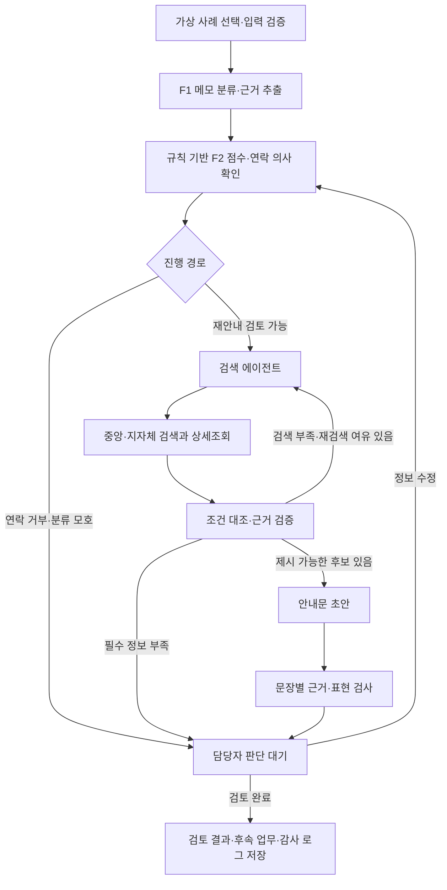

# codex advisor artifact

- Provider: codex
- Exit code: 0
- Created at: 2026-11-12T15:24:26.381Z

## Original task

너는 공공부문 LLM 에이전트 시스템 설계자다. 웹 검색으로 최신(2025~2026) 에이전트 설계 관행을 확인하며, 아래 프로토타입의 'AI Agent 아키텍처'를 설계해라. 근거가 불확실하면 "확인 필요". 과장 금지.

[과제] 「안내종결」: 위기가구로 발굴됐지만 '상담 안내'만 받고 종결된 가구(2025년 20만6,966명)를 다시 놓치지 않게 하는 AI. 사용자 = 읍면동 찾아가는 보건복지팀 공무원. 2026 사회보장 데이터 AI 경진대회 출품용(대학 3학년 팀, 개발 기간 약 5일, 본선 5분 발표 중 라이브 시연). 심사 배점: 사회보장 데이터 활용 25 / AI 혁신성 20 / 구체성 15 / 독창성 15 / 발전·사업화 20 / ESG 5.

[확보된 데이터 — 실제 호출 성공]
- 지자체복지서비스 API: https://apis.data.go.kr/B554287/LocalGovernmentWelfareInformations/LcgvWelfarelist (목록, ctpvNm/sggNm/lifeArray/trgterIndvdlArray/intrsThemaArray/age/searchWrd 필터) + 상세조회(servId) — 서울 397건. 필드: servId, servNm, ctpvNm, sggNm, servDgst, lifeNmArray, trgterIndvdlNmArray, intrsThemaNmArray, sprtCycNm, srvPvsnNm, aplyMtdNm, bizChrDeptNm, servDtlLink, (상세) sprtTrgtCn 지원대상, slctCritCn 선정기준, alwServCn 급여내용, aplyMtdCn 신청방법, enfcBgngYmd/enfcEndYmd. XML.
- 중앙부처복지서비스 API: https://apis.data.go.kr/B554287/NationalWelfareInformationsV001/NationalWelfarelistV001 (callTp=L 목록, D 상세) — 461건. 필드: servId, servNm, jurMnofNm, servDgst, lifeArray, trgterIndvdlArray, intrsThemaArray, onapPsbltYn, rprsCtadr, servDtlLink 등.
- 파일: 정보원 '복지사업 시군구별 수급권자 현황'(사업명, 기준년월, 시도, 시군구, 수급권자수, 수급가구수, 2025.12.31), 주택관리공단 단지별 고독사 현황.
- 통계: 시도별 위기가구 지원율(서울 34.7% 최저), 고독사 50~60대 62.9%·남성 81.7%, 위기정보 47→50종(단전·단수·단가스·건보료 체납·관리비 체납·금융연체 등).
- 실제 발굴이력·상담메모는 비공개 → 통계 분포에 맞춘 가상 데이터(개인정보 없음) 생성 필요.

[기능 요구]
F1 종결 메모 분류: 담당자 자유서술 메모 → 업무상태(조사중/종결) + 종결사유(거부/미응답/연락불가/부적합/안내만/타기관연계 등, 복수) + 근거 구절.
F2 재접촉 우선순위: 반복발굴 이력, 위기신호 누적·악화, F1 결과, 고독사 고위험 특성 → 설명가능 점수 + 항목별 기여.
F3 맞춤 재안내: 가구 상황 → 두 API에서 해당 시군구·중앙 서비스 검색 → 조건 대조 → 후보 2~3개 + 근거(servId, 원문 조건) + 쉬운 말 안내문 초안.
F4 담당자 검토/수정/결과 기록(Human-in-the-loop) 및 감사 로그.

[요청]
1. 에이전트 구조 선택지 2~3개 비교(예: 단일 LLM 파이프라인 vs 도구호출(tool-calling) 단일 에이전트 vs 멀티에이전트/워크플로 그래프). 각자의 장단점을 '5일 개발·라이브 시연 안정성·AI 혁신성 점수·설명가능성' 관점에서 평가하고 하나를 추천.
2. 추천 구조의 상세 설계: 에이전트/노드 목록, 각 도구(tool) 정의(이름·입력·출력·호출 API), 상태(state) 스키마, 프롬프트 설계 요점, 구조화 출력 스키마(JSON), 가드레일(자격 단정 금지, 근거 없는 서비스 추천 금지, 거부 의사 존중, 개인정보 최소화), 실패 시 폴백.
3. RAG 설계: 858건 서비스를 어떻게 색인(필드 선택, 임베딩 vs 키워드 vs 하이브리드), 메타데이터 필터(시군구·생애주기·가구상황), 조건 대조 방법, 캐싱(시연 중 API 장애 대비).
4. F2 점수: 규칙 기반 vs 학습 모델 vs LLM 판단의 조합 제안. 가상 데이터만 있을 때 정직하게 할 수 있는 방식. 설명가능성 표현 방법.
5. 가상 데이터 생성 설계: 가구 수, 필드, 통계 분포 반영 방법, 메모 텍스트 생성(LLM으로 다양한 문체·오타·약어), 정답 라벨 설계.
6. 평가 설계: F1 분류 정확도/F1점수, F3 근거 일치율(hallucination 체크), 비교 기준선(키워드 규칙, 단순 검색), 표본 수, 사람 검수 방법.
7. 기술 스택 추천(Python, LLM 공급자 무관하게 교체 가능하도록, 프레임워크 사용 여부 — LangGraph/OpenAI Agents SDK/Claude Agent SDK/순수 코드 비교, Streamlit UI), 디렉터리 구조, 5일 개발 일정.
8. 심사위원이 'AI 혁신성'을 높게 보도록 시연에서 보여줄 '에이전트다운' 장면 3개.
한국어로, 표와 JSON 예시 포함.

## Final prompt

너는 공공부문 LLM 에이전트 시스템 설계자다. 웹 검색으로 최신(2025~2026) 에이전트 설계 관행을 확인하며, 아래 프로토타입의 'AI Agent 아키텍처'를 설계해라. 근거가 불확실하면 "확인 필요". 과장 금지.

[과제] 「안내종결」: 위기가구로 발굴됐지만 '상담 안내'만 받고 종결된 가구(2025년 20만6,966명)를 다시 놓치지 않게 하는 AI. 사용자 = 읍면동 찾아가는 보건복지팀 공무원. 2026 사회보장 데이터 AI 경진대회 출품용(대학 3학년 팀, 개발 기간 약 5일, 본선 5분 발표 중 라이브 시연). 심사 배점: 사회보장 데이터 활용 25 / AI 혁신성 20 / 구체성 15 / 독창성 15 / 발전·사업화 20 / ESG 5.

[확보된 데이터 — 실제 호출 성공]
- 지자체복지서비스 API: https://apis.data.go.kr/B554287/LocalGovernmentWelfareInformations/LcgvWelfarelist (목록, ctpvNm/sggNm/lifeArray/trgterIndvdlArray/intrsThemaArray/age/searchWrd 필터) + 상세조회(servId) — 서울 397건. 필드: servId, servNm, ctpvNm, sggNm, servDgst, lifeNmArray, trgterIndvdlNmArray, intrsThemaNmArray, sprtCycNm, srvPvsnNm, aplyMtdNm, bizChrDeptNm, servDtlLink, (상세) sprtTrgtCn 지원대상, slctCritCn 선정기준, alwServCn 급여내용, aplyMtdCn 신청방법, enfcBgngYmd/enfcEndYmd. XML.
- 중앙부처복지서비스 API: https://apis.data.go.kr/B554287/NationalWelfareInformationsV001/NationalWelfarelistV001 (callTp=L 목록, D 상세) — 461건. 필드: servId, servNm, jurMnofNm, servDgst, lifeArray, trgterIndvdlArray, intrsThemaArray, onapPsbltYn, rprsCtadr, servDtlLink 등.
- 파일: 정보원 '복지사업 시군구별 수급권자 현황'(사업명, 기준년월, 시도, 시군구, 수급권자수, 수급가구수, 2025.12.31), 주택관리공단 단지별 고독사 현황.
- 통계: 시도별 위기가구 지원율(서울 34.7% 최저), 고독사 50~60대 62.9%·남성 81.7%, 위기정보 47→50종(단전·단수·단가스·건보료 체납·관리비 체납·금융연체 등).
- 실제 발굴이력·상담메모는 비공개 → 통계 분포에 맞춘 가상 데이터(개인정보 없음) 생성 필요.

[기능 요구]
F1 종결 메모 분류: 담당자 자유서술 메모 → 업무상태(조사중/종결) + 종결사유(거부/미응답/연락불가/부적합/안내만/타기관연계 등, 복수) + 근거 구절.
F2 재접촉 우선순위: 반복발굴 이력, 위기신호 누적·악화, F1 결과, 고독사 고위험 특성 → 설명가능 점수 + 항목별 기여.
F3 맞춤 재안내: 가구 상황 → 두 API에서 해당 시군구·중앙 서비스 검색 → 조건 대조 → 후보 2~3개 + 근거(servId, 원문 조건) + 쉬운 말 안내문 초안.
F4 담당자 검토/수정/결과 기록(Human-in-the-loop) 및 감사 로그.

[요청]
1. 에이전트 구조 선택지 2~3개 비교(예: 단일 LLM 파이프라인 vs 도구호출(tool-calling) 단일 에이전트 vs 멀티에이전트/워크플로 그래프). 각자의 장단점을 '5일 개발·라이브 시연 안정성·AI 혁신성 점수·설명가능성' 관점에서 평가하고 하나를 추천.
2. 추천 구조의 상세 설계: 에이전트/노드 목록, 각 도구(tool) 정의(이름·입력·출력·호출 API), 상태(state) 스키마, 프롬프트 설계 요점, 구조화 출력 스키마(JSON), 가드레일(자격 단정 금지, 근거 없는 서비스 추천 금지, 거부 의사 존중, 개인정보 최소화), 실패 시 폴백.
3. RAG 설계: 858건 서비스를 어떻게 색인(필드 선택, 임베딩 vs 키워드 vs 하이브리드), 메타데이터 필터(시군구·생애주기·가구상황), 조건 대조 방법, 캐싱(시연 중 API 장애 대비).
4. F2 점수: 규칙 기반 vs 학습 모델 vs LLM 판단의 조합 제안. 가상 데이터만 있을 때 정직하게 할 수 있는 방식. 설명가능성 표현 방법.
5. 가상 데이터 생성 설계: 가구 수, 필드, 통계 분포 반영 방법, 메모 텍스트 생성(LLM으로 다양한 문체·오타·약어), 정답 라벨 설계.
6. 평가 설계: F1 분류 정확도/F1점수, F3 근거 일치율(hallucination 체크), 비교 기준선(키워드 규칙, 단순 검색), 표본 수, 사람 검수 방법.
7. 기술 스택 추천(Python, LLM 공급자 무관하게 교체 가능하도록, 프레임워크 사용 여부 — LangGraph/OpenAI Agents SDK/Claude Agent SDK/순수 코드 비교, Streamlit UI), 디렉터리 구조, 5일 개발 일정.
8. 심사위원이 'AI 혁신성'을 높게 보도록 시연에서 보여줄 '에이전트다운' 장면 3개.
한국어로, 표와 JSON 예시 포함.

## Raw output

```text
추천은 **‘도구호출 단일 에이전트 + 코드가 통제하는 업무 흐름’**이다. 구현은 **Python·Pydantic·SQLite·Streamlit**로 시작하고, 검색 결과에 따라 재검색하거나 담당자에게 추가 정보를 요청하는 부분에만 에이전트의 자율성을 둔다.

「안내종결」의 목표는 **종결 기록에서 재검토할 사례를 찾고, 확인 가능한 서비스와 다음 업무를 제시하는 것**이다. 수급 자격 판정이나 고독사 위험 예측까지 주장하면 현재 데이터로는 뒷받침하기 어렵다.

아래 가중치·표본 수·성능 목표·개발 일정은 **이번 시제품을 위한 설계 제안이며, 검증된 운영 기준이나 측정 결과가 아니다.**

**설계에 반영할 최신 근거와 데이터 전제**

2025~2026년 자료에서 확인되는 실용적인 방향은 도구의 경계를 명확히 하고, 실행 상태를 기록하며, 자동 검증과 사람의 검토를 결합하는 것이다.

| 확인한 공식 자료 | 이번 설계에 적용할 내용 |
|---|---|
| Anthropic, 2025.9.11: 도구 설계 지침 | 업무 단위로 도구를 묶고, 입력·출력·오류 의미를 명확히 정의한다. [공식 문서](https://www.anthropic.com/research/writing-tools-for-agents) |
| Anthropic, 2026.1.9: 에이전트 평가 지침 | 코드 검사·모델 평가·사람 검수를 조합하고, 최종 답변뿐 아니라 도구 실행 기록도 평가한다. [공식 문서](https://www.anthropic.com/research/demystifying-evals-for-ai-agents) |
| OpenAI, 현재 Agents SDK 문서 | 자동 가드레일과 사람의 승인 절차를 구분한다. [공식 문서](https://developers.openai.com/api/docs/guides/agents/guardrails-approvals) |
| LangGraph, 현재 문서 | 규칙 실행과 LLM 실행을 같은 상태 그래프에서 관리하고, 중단·재개를 구현할 수 있다. 그래프 사용이 곧 멀티에이전트를 의미하지 않는다. [공식 문서](https://docs.langchain.com/oss/python/langgraph/overview) |

데이터를 설명할 때는 다음 구분이 필요하다.

- **20만 6,966은 ‘명’ 단위다.** 2026년 10월 보도에서 2025년 상담 안내 종결 인원으로 확인된다. 발표에서 이를 ‘20만 6,966가구’로 바꾸면 안 된다. 중복 제거 방식과 상세 집계 정의는 의원실·정보원 원자료 **확인 필요**다. [관련 보도](https://www.mt.co.kr/policy/2026/10/22/2026102122051887593)
- **858건은 확보한 시점의 서비스 목록 규모다.** 서울 지자체 397건과 중앙 461건이며, 전국 모든 복지서비스를 포괄한다고 표현하지 않는다. 목록 확보율과 상세 조건 확보율도 구분한다.
- **고독사 연령·성별 비중은 사망자 집단의 구성비다.** 일반 위기가구의 구성비나 개인의 사망확률로 전환할 수 없다. 정부 공개 자료에서도 남성 81.7%, 50대 30.5%·60대 32.4%가 확인된다. [정부 공개 자료](https://gonggam.korea.kr/newsContentView.es?mid=a12505000000&news_id=7e2d3f51-2dd8-4887-8c61-2467833cb3a3)
- **위기정보 50종 확대는 2026년 9월 정부 발표에서 확인된다.** 개별 항목의 실제 연계 시점과 제공 가능 범위는 별도 **확인 필요**다. 시제품에서는 확보하지 않은 원천정보를 연동했다고 표현하지 않는다. [보건복지부 발표](https://www.korea.kr/briefing/pressReleaseView.do?newsId=156782846)

---

**1. 세 가지 구조 중, 제한된 단일 에이전트가 개발 부담과 시연 효과의 균형이 가장 좋다.**

‘단일 LLM’은 한 번만 호출한다는 뜻으로 사용하지 않는다. 같은 모델을 여러 단계에서 호출할 수 있다.

| 구조 | 5일 개발 | 라이브 시연 안정성 | AI 혁신성에 보여줄 근거 | 설명가능성 | 주요 한계 |
|---|---|---|---|---|---|
| **A. 고정 LLM 파이프라인**: 분류 → 정해진 검색 → 안내문 | 가장 쉬움 | 높음 | 문맥 분류, 근거 기반 생성 | 단계별 입출력 추적이 쉬움 | 결과가 부족해도 검색 전략을 바꾸기 어려움 |
| **B. 제한된 도구호출 단일 에이전트 + 고정 업무 흐름** | 충분히 가능 | 호출 횟수·시간을 제한하면 높음 | 검색 결과를 보고 재검색·상세조회·추가 질문을 선택 | 도구 기록과 조건 대조표로 설명 가능 | 도구 선택 오류와 반복 호출을 통제해야 함 |
| **C. 분류·검색·검증·작성 멀티에이전트** | 부담 큼 | 상대적으로 낮음 | 역할별 협업을 보여줄 수 있음 | 각 역할의 출력은 추적 가능하나 충돌 처리가 복잡 | 지연·비용·상태 불일치 증가. 에이전트 간 합의가 정확성을 보장하지 않음 |

**B를 추천한다.** 다만 실제 심사 점수는 예측할 수 없다. 혁신성은 에이전트 수보다 다음 행동을 결정하는 능력과 그 효과를 비교평가로 보여주는 편이 설득력 있다.

구현 범위는 다음처럼 나눈다.

- **코드가 결정:** 개인정보 제거, 데이터 접근 범위, 점수 계산, 도구 허용 여부, 근거 검증, 승인·저장.
- **LLM이 수행:** 메모 문맥 해석, 검색어 선택, 검색 결과에 따른 다음 행동 선택, 복잡한 조건 해석, 쉬운 말 작성.
- **담당자가 결정:** 모호한 분류 확정, 사실관계 수정, 재접촉 여부·방법, 결과 기록.

---

**2. 추천 구조는 하나의 검색 에이전트를 중심으로, 검증 가능한 노드들을 연결한다.**



그래프의 각 상자는 독립 에이전트가 아니다. 대부분 일반 함수이고, **검색 에이전트만 도구 결과를 보고 다음 행동을 선택**한다.

| 노드 | 처리 방식 | 핵심 출력 |
|---|---|---|
| 입력 정리 | 코드 | 가구 ID, 기준시점, 정제한 메모, 사실별 출처 |
| 메모 분류 | LLM + 스키마 검사 | 업무상태, 복수 종결사유, 근거 구절, 연락 의사 |
| 우선순위 계산 | 규칙 | 총점, 항목별 점수, 누락 정보 |
| 행동 경로 결정 | 코드 | 재안내 검토 / 담당자 판단 대기 / 기존 업무 계속 |
| 서비스 탐색 | 도구호출 에이전트 | 검색 조건, 후보 ID, 추가 조회·질문 |
| 조건 대조 | 코드 + 제한적 LLM | 조건별 충족·불충족·확인 필요 |
| 안내문 작성 | LLM | 검증된 후보에 관한 쉬운 말 초안 |
| 출력 검증 | 코드 + 담당자 검토 | 인용 유효성, 금액·기한·조건 누락 검사 |
| 검토·저장 | UI + 코드 | 수정 내용, 검토 결정, 후속 업무, 감사 이벤트 |

실행 제한은 서버 코드에 둔다. 초기 제안은 **검색 2회, 상세조회 최대 6개 서비스, 전체 LLM 호출 최대 7회, 전체 실행 45초**다. 제한에 도달하면 현재까지 확인한 결과와 미확인 사항을 제시하고 멈춘다. 실제 시간 제한은 개발 중 측정해 조정한다.

**도구는 업무 목적과 권한을 함께 정의한다.**

아래의 ‘내부’ 도구는 애플리케이션이 호출하며, LLM에 실행 권한을 주지 않는다.

| 도구 | 입력 | 출력 | 호출 API·저장소 | 실행 주체 |
|---|---|---|---|---|
| `load_case` | `case_id`, `case_version` | 사실, 메모, 발굴 이력, 연락 의사 | SQLite | 내부 |
| `score_review_priority` | 사례 스냅샷, `policy_version` | 점수·기여도·누락 항목 | 외부 API 없음 | 내부 |
| `search_services` | 검색어, `source`, 지역, 생애주기·가구상황, `top_k` | 서비스 ID, 요약, 검색 점수, 데이터 시점 | 지자체 목록 + 중앙 목록, 로컬 색인 | 에이전트 |
| `get_service_details` | 검색 결과에 존재하는 서비스 키 목록 | 지원대상·선정기준·급여·신청방법·출처 | 지자체 상세조회 `servId`; 중앙 `callTp=D` | 에이전트 |
| `request_staff_input` | 필요한 필드, 필요한 이유, 관련 조건 ID | 검토 대기 상태 | Streamlit 입력 화면 | 에이전트 |
| `compare_conditions` | 사실 참조, 상세 조건, 기준일 | 조건별 판정·미확인 항목·탈락 근거 | 로컬 규칙·조건 해석 모듈 | 내부 |
| `verify_evidence` | 후보·안내문·인용 참조 | 통과 여부, 오류 목록 | 고정된 원문 스냅샷 | 내부 |
| `save_review` | 실행 ID, 예상 버전, 검토 결정, 수정, 사유, 중복방지 키 | 저장 버전, 감사 이벤트 ID | SQLite 트랜잭션 | 담당자 UI |
| `record_outcome` | 검토 ID, 실제 처리 결과, 확인일, 후속일 | 결과 기록·다음 업무 | SQLite | 담당자 UI |

API 연결 원칙은 다음과 같다.

- 지자체 목록은 제공된 `LcgvWelfarelist`와 검증된 필터를 사용한다.
- 중앙 목록은 제공된 `NationalWelfarelistV001`의 `callTp=L`을 사용한다. **지자체 API와 같은 필터가 중앙에도 있다고 가정하지 않는다.**
- 생애주기·가구상황 코드는 공식 코드표로 매핑한다. 문자열 이름을 코드 자리에 그대로 넣지 않는다.
- 중앙 상세 필드는 실제 응답을 확인해 공통 스키마로 변환한다. 지자체와 필드명이 같다고 가정하지 않는다.
- API 인증키와 요청 URL은 코드가 관리한다. LLM은 임의 URL을 만들거나 인증키를 볼 수 없다.

지자체 API의 목록·상세 구분, XML 형식, 상세 조건 필드는 공공데이터포털 명세에서도 확인된다. [공식 API 명세](https://www.data.go.kr/data/15108347/openapi.do)

**상태는 대화문 전체보다 업무에 필요한 구조화 정보를 중심으로 저장한다.**

| 상태 필드 | 내용 |
|---|---|
| `run_id`, `case_id`, `case_version` | 실행·사례·입력 버전 |
| `as_of`, `is_synthetic` | 판단 기준일, 가상 데이터 여부 |
| `facts` | 값, 출처, 확인 시점, 확인 상태 |
| `notes` | 메모 ID, 작성일, 개인정보를 제거한 원문 |
| `classification` | 업무상태, 종결사유, 근거, 검토 필요 여부 |
| `contact_preference` | 동의·거부·미확인, 대상 서비스·채널·유효 시점 |
| `priority` | 점수, 기여도, 누락 정보, 규칙 버전 |
| `retrieval` | 검색 이력, 서비스 키, 목록·상세 확보 상태 |
| `condition_checks` | 조건 ID, 원문 참조, 사실 참조, 판정 |
| `draft` | 후보, 안내문, 문장별 근거 참조 |
| `review` | 검토 상태, 담당자 수정, 사유, 승인 대상 해시 |
| `provenance`, `execution` | 데이터·모델·프롬프트 버전, 호출 수, 지연, 오류·폴백 |

사례 사실을 수정하면 해당 사실에 의존하는 점수·조건 대조·안내문을 무효화한다. **수정 전 결과에 대한 승인이 수정 후 결과에도 남아 있으면 안 된다.**

**F1 구조화 출력은 최소한 아래 계약을 따른다.**

업무상태에는 요청한 조사중·종결 외에 내부적으로 `판단보류`를 둔다. 모호한 메모를 강제로 이분류하지 않기 위해서다.

```json
{
  "type": "object",
  "additionalProperties": false,
  "required": [
    "work_status",
    "status_evidence",
    "closure_reasons",
    "contact_preference",
    "needs_review"
  ],
  "properties": {
    "work_status": {
      "enum": ["조사중", "종결", "판단보류"]
    },
    "status_evidence": {
      "type": "array",
      "items": {"$ref": "#/$defs/evidence"}
    },
    "closure_reasons": {
      "type": "array",
      "items": {
        "type": "object",
        "additionalProperties": false,
        "required": ["code", "evidence"],
        "properties": {
          "code": {
            "enum": [
              "거부", "미응답", "연락불가",
              "부적합", "안내만", "타기관연계", "기타"
            ]
          },
          "evidence": {
            "type": "array",
            "minItems": 1,
            "items": {"$ref": "#/$defs/evidence"}
          }
        }
      }
    },
    "contact_preference": {
      "type": "object",
      "additionalProperties": false,
      "required": ["status", "scope", "evidence"],
      "properties": {
        "status": {"enum": ["동의", "거부", "미확인"]},
        "scope": {"type": ["string", "null"]},
        "evidence": {
          "type": "array",
          "items": {"$ref": "#/$defs/evidence"}
        }
      }
    },
    "needs_review": {"type": "boolean"}
  },
  "$defs": {
    "evidence": {
      "type": "object",
      "additionalProperties": false,
      "required": ["note_id", "sentence_id", "quote"],
      "properties": {
        "note_id": {"type": "string"},
        "sentence_id": {"type": "string"},
        "quote": {"type": "string"}
      }
    }
  }
}
```

추가 검증은 코드로 처리한다.

- 근거 구절이 해당 메모에 실제로 존재하는가?
- 종결이 아닌 현재 상담에 과거 종결사유를 잘못 붙이지 않았는가?
- ‘부적합하지 않음’, ‘과거에는 거부했으나 지금은 동의’ 같은 부정·시간 표현을 반영했는가?
- 서비스 신청 거절을 모든 연락에 대한 거부로 확대하지 않았는가?
- `판단보류`이면 반드시 검토 대상으로 보냈는가?

구조화 출력은 형식을 안정시키지만 내용의 사실성을 보장하지 않는다. OpenAI 공식 문서도 구조화 출력에 오류가 남을 수 있다고 명시한다. [공식 문서](https://developers.openai.com/api/docs/guides/structured-outputs)

**F3 출력에는 조건별 대조 결과를 남긴다.**

다음은 **실재 서비스가 아닌 스키마 설명용 가상 예시**다. 실제 시연에서는 확보한 `servId`와 원문으로 교체해야 한다.

```json
{
  "is_example": true,
  "service_key": "local:EXAMPLE_ONLY_001",
  "servId": "EXAMPLE_ONLY_001",
  "candidate_status": "확인 필요",
  "checks": [
    {
      "condition_id": "C1",
      "source_field": "sprtTrgtCn",
      "quote": "만 50세 이상 1인가구",
      "fact_refs": ["age", "household_size"],
      "result": "matched"
    },
    {
      "condition_id": "C2",
      "source_field": "slctCritCn",
      "quote": "소득인정액이 기준 중위소득 75% 이하",
      "fact_refs": ["income_recognition_ratio"],
      "result": "unknown"
    }
  ],
  "missing_information": [
    "가구 규모와 기준연도를 반영한 소득인정액 확인"
  ],
  "draft_text": "연령과 가구 형태는 안내된 조건에 맞습니다. 소득 기준은 추가 확인이 필요합니다.",
  "claim_evidence": [
    {"claim_id": "S1", "condition_ids": ["C1"]},
    {"claim_id": "S2", "condition_ids": ["C2"]}
  ],
  "requires_staff_review": true
}
```

`matched`는 **그 조건 하나가 제공된 사실과 맞는다는 뜻**이다. 서비스 전체 자격이나 지급 확정이라는 뜻이 아니다.

**프롬프트는 역할별로 짧게 분리한다.**

| 호출 | 반드시 넣을 지시 |
|---|---|
| F1 분류 | 현재 상담과 과거 이력을 구분하라. 복수 사유를 허용하라. 원문 구절을 인용하라. 불명확하면 판단보류하라. |
| 검색 에이전트 | 확보된 사실만 사용하라. 결과가 부족하면 검색어·주제 태그를 바꿀 수 있다. 확인된 지역·연령 조건을 임의로 완화하지 말라. |
| 조건 해석 | AND·OR·예외·제외 조건을 보존하라. 소득과 소득인정액을 동일시하지 말라. 정보가 없으면 unknown으로 반환하라. |
| 안내문 작성 | 검증된 후보와 근거만 사용하라. 금액·기간·신청방법을 새로 만들지 말라. 미확인 조건을 쉬운 말로 설명하라. |

메모와 API 응답은 **분석 대상 데이터**로 취급한다. 그 안에 “이전 지시를 무시하라” 같은 문장이 있어도 도구 실행 지시로 따르지 않는다.

**가드레일과 폴백은 다음처럼 연결한다.**

| 상황 | 처리 |
|---|---|
| 수급 자격 단정 | ‘수급 가능 확정’ 대신 ‘검토 후보·확인 필요’로 표시. 최종 결정 기능은 두지 않음 |
| 존재하지 않는 서비스·인용 | 조회 결과에 없는 ID, 원문에 없는 인용은 출력 차단 |
| 명확한 연락 거부 | 재접촉 실행 경로를 보류. 거부 범위·시점을 담당자에게 표시 |
| 거부 의사와 새로운 위기신호가 함께 존재 | 점수로 거부를 덮어쓰지 않음. 기관 절차에 따른 담당자 판단으로 전달 |
| 정보 누락 | 미충족으로 단정하지 않고 추가 확인 항목으로 표시 |
| 개인정보 | 시연은 가상 데이터만 사용. API 검색에는 일반화한 필요·지역 조건만 전달 |
| LLM 오류·JSON 실패 | 수정 요청 1회 후 규칙 분류·원문 검색 결과를 제시하고 검토 대기 |
| API 장애 | 검증된 스냅샷 사용, 수집일과 캐시 사용 표시 |
| 상세 조건 미확보 | 목록 요약만으로 맞춤 자격 추천하지 않고 ‘상세 확인 필요’로 이동 |
| 후보 없음 | 0개를 허용. 2~3개를 채우려고 부적합 서비스를 추가하지 않음 |
| 중복 클릭·저장 | 실행 ID·버전·중복방지 키로 중복 기록 방지 |

감사 로그에는 입력 버전, 사용 데이터 해시, 모델·프롬프트·규칙 버전, 도구 실행, 근거, 담당자 수정 전후와 사유를 남긴다. SQLite의 추가 기록 방식은 시연용으로 충분하지만, **변조 불가능한 감사 체계를 구현했다고 주장하지 않는다.**

---

**3. RAG는 858건을 서비스 단위로 관리하고, 검색과 자격 조건 대조를 분리한다.**

**목록은 발견에, 상세 원문은 근거에 사용한다.**

| 용도 | 사용할 필드 |
|---|---|
| 검색 문서 | `servNm`, `servDgst`, 생애주기·가구상황·관심주제 |
| 조건 검색 | `sprtTrgtCn`, `slctCritCn` |
| 안내문 근거 | `alwServCn`, `aplyMtdCn`, 공식 문의처·링크 |
| 메타데이터 | 출처, `servId`, 지역, 시행 기간, 수집일, 수정일이 있으면 수정일 |
| 추적 정보 | 원본 XML, 정규화한 본문, 필드·문장 ID, 내용 해시 |

서비스 키는 `local:{servId}` 또는 `national:{servId}`로 만든다. 같은 이름의 사업도 자동으로 하나로 합치지 않는다.

문서는 다음 방식으로 나눈다.

- 서비스 요약 문서 1개.
- 지원대상·선정기준·급여내용·신청방법을 필드별 문서로 분리.
- 조건이 길면 조항 경계로 나누되, **예외와 본문 조건의 관계를 유지**한다.
- 검색은 일부 문단으로 하더라도 최종 대조에는 해당 조건의 주변 문맥을 함께 제공한다.

**검색은 소규모 하이브리드 구성이 적합하다.**

| 방식 | 장점 | 약점 | 적용 |
|---|---|---|---|
| BM25·키워드 | 사업명, 지역명, ‘체납’ 같은 정확한 용어에 강함 | 생활 표현과 행정 용어 차이에 약함 | 필수 |
| 임베딩 | ‘월세 밀림 → 주거비 지원’ 같은 의미 연결 | 비슷해 보여도 자격이 다른 사업을 가져올 수 있음 | 보완 |
| 하이브리드 | 정확한 용어와 의미 검색을 함께 활용 | 검색 품질을 비교해야 함 | 추천 |

초기 설정 예시는 다음과 같다.

```text
지역 범위 선택
→ BM25 상위 20개 + 임베딩 상위 20개
→ RRF로 순위 결합
→ 서비스 ID별 중복 정리
→ 상위 최대 6개 상세 확인
→ 조건 대조
→ 검토 후보 최대 3개
```

RRF 결합 상수 등은 개발용 설정이며 검증된 최적값으로 표현하지 않는다. 858건 규모에서는 **SQLite + 메모리에 올린 임베딩 배열**로 시작할 수 있다. 별도 벡터 데이터베이스 운영은 필수가 아니다.

한국어 임베딩은 한 종류를 선택해 고정하고, 생활어·행정어 질의 약 30개로 BM25 대비 이득을 먼저 확인한다. 임베딩 장애 시 BM25로 검색을 계속한다.

**필터는 적용 강도를 구분한다.**

- **지역:** 해당 시군구 사업 + 적용 가능한 시도 공통 사업 + 중앙 사업을 함께 검색한다.
- **중앙 사업:** 중앙부처 사업이어도 특정 지역 시범사업인지 상세 조건을 확인한다.
- **생애주기·가구상황:** 목록 태그는 우선 검색 가중치로 사용한다. 태그 누락만으로 후보를 제외하지 않는다.
- **연령·거주지:** 상세 원문에 명시된 필수 조건이 있고 사실이 확인됐을 때 코드로 대조한다.
- **지역·기간 미상:** 전국 대상·상시 운영으로 자동 해석하지 않는다.
- **시행 기간:** 시행 시작·종료일을 접수 기간과 동일시하지 않는다. 접수 기간은 신청방법·공고에서 별도로 확인한다.

**조건 대조는 네 가지 상태로 표현한다.**

| 상태 | 의미 |
|---|---|
| `matched` | 확인된 사실이 해당 조건을 충족 |
| `not_matched` | 확인된 사실이 해당 조건과 명확히 불일치 |
| `unknown` | 가구 정보 또는 서비스 조건이 부족 |
| `conflict` | 원문 간 또는 가구 사실 간 모순 |

연령·기간·지역·명확한 수치 비교는 코드가 담당한다. LLM은 복합 조건을 구조화하는 데 사용한다. 5일 안에 모든 복지사업의 조건을 완전한 규칙으로 변환하기는 어렵기 때문에 **시연에 사용하는 30~50개 서비스의 조건을 우선 사람이 검수**한다.

확인된 필수 조건에 불일치하면 기본 추천에서 제외하고 이유를 남긴다. 미확인 조건이 있는 후보는 ‘확인 필요’ 묶음으로 구분한다.

**캐시는 답변 캐시보다 근거 데이터 캐시를 우선한다.**

1. 목록·상세 XML과 정규화 데이터를 사전 수집한다.
2. 수집 성공 건수, 상세 확보 건수, 실패 ID를 manifest에 기록한다.
3. 정상 응답과 필수 필드를 검증한 뒤 기존 캐시를 교체한다.
4. 시연은 고정 스냅샷으로 재현 가능하게 실행한다.
5. 최신 조회를 켰을 때 장애가 나면 스냅샷으로 전환하고 수집일을 표시한다.

858건 상세 전체 수집이 호출 한도 안에서 가능한지는 **확인 필요**다. 실패하면 “목록 858건·상세 조건 확보 ○건”으로 정확히 표시한다.

LLM 응답을 사전 저장한 재생 시연도 준비할 수 있지만, 화면에 **‘사전 실행 결과 재생’**이라고 표시해야 한다. 입력을 수정했는데 이전 답변을 실시간 생성 결과처럼 보여주면 안 된다.

확보한 다른 파일은 다음처럼 활용한다.

| 데이터 | 적절한 활용 | 피할 해석 |
|---|---|---|
| 시군구별 수급권자·수급가구 현황 | 지역·사업별 이용 현황, 서비스 목록과의 매핑 결과 표시 | 수급자 수만으로 미충족 수요나 개인 자격 추정 |
| 단지별 고독사 현황 | 문제 배경·지역 단위 참고 분석 | 해당 단지 거주자 모두에게 위험 가점 부여 |
| 지역별 지원율 | 서울을 시연 지역으로 정한 배경 | 지역 공무원의 성과나 특정 가구의 위험을 단정 |

사업명으로 두 데이터를 연결할 때는 수동 검수한 매핑표를 사용하고, 매핑 성공률과 미연결 항목도 공개한다.

---

**4. F2는 규칙 기반 점수를 사용하고, LLM은 점수의 입력을 추출하는 역할로 제한한다.**

가상 데이터만 있는 상황에서 가장 정직한 조합은 다음과 같다.

> **LLM으로 메모를 구조화 → 코드로 검토 우선순위 계산 → 담당자가 수정·확정**

이 점수의 이름은 **‘재검토 우선순위’**가 적절하다. ‘고독사 확률’, ‘위기가구 예측 정확도’라는 표현은 사용하지 않는다.

다음은 100점 만점의 **초기 가설 규칙**이다.

| 항목 | 제안 점수 | 계산 예시 |
|---|---:|---|
| 반복 발굴 `R` | 0~20 | 관찰 기간 내 1회 0점, 2회 10점, 3회 이상 20점 |
| 현재 위기신호 범위 `C` | 0~20 | 서로 다른 활성 위기영역당 5점, 최대 20점 |
| 악화·추가 발생 `W` | 0~20 | 새 영역 발생 10점, 명시적 악화 20점. 합산하지 않고 최댓값 |
| 종결 이후 지원 연결 공백 `F` | 0~20 | 안내만 20점, 미응답·연락불가 또는 연계 미완료 확인 10점, 나머지 0점 |
| 확인된 고립·생활 취약성 `I` | 0~20 | 1인가구 5점, 도움 관계망 부재 확인 10점, 일상생활 제약 확인 5점 |

\[
S=R+C+W+F+I
\]

위기정보는 중복 신호를 그대로 더하지 않고 생계·주거·공공요금·건강·금융 등으로 묶는다. 영역 분류 자체도 검수할 정책 설정이다.

현재 신호 범위와 악화 항목은 상관될 수 있으므로 가중치를 바꿨을 때 순위가 얼마나 변하는지 확인한다. 특정 사건이 여러 항목에 반영되는 구조를 숨기지 않는다.

예시 설명은 다음처럼 제시한다.

> **재검토 우선순위 75점**  
> 최근 관찰 기간 3회 발굴 +20  
> 현재 위기영역 2개 +10  
> 이전보다 위기영역 1개 증가 +10  
> 안내만 하고 종결 +20  
> 1인가구이며 도움 관계망 부재 확인 +15

각 줄을 누르면 원래 이력·메모·규칙을 보여준다. 이 방식에는 SHAP이 필요하지 않다. 점수 기여가 계산식 자체에 드러나기 때문이다.

중요한 예외는 다음과 같다.

- **성별·50~60대 여부는 기본 점수에 직접 넣지 않는다.** 현재 가진 통계로는 개인별 위험 가중치를 정당화하기 어렵다. 대신 서비스 탐색, 사례 다양성 확보, 집단별 결과 점검에 사용한다.
- **연락 거부는 점수 항목과 별도로 관리한다.** 고득점이어도 연락 허용 상태로 바뀌지 않는다.
- **미확인은 0점과 구별한다.** 확인된 점수와 미확인 항목을 함께 보여주고, 필요한 경우 가능한 점수 범위를 표시한다.
- **조사중·분류 모호 사례는 별도 검토함으로 보낸다.** 종결 사례 목록에 자동 혼합하지 않는다.
- **점수로 서비스를 배제하지 않는다.** 담당자의 검토 순서를 보조하며, 낮은 점수도 직접 열람할 수 있게 한다.

관찰 기간은 시제품에서 예를 들어 180일로 설정할 수 있지만, 실제 운영에서는 허용된 데이터 보유·연계 범위에 맞춰야 한다. 관련 보도는 위기정보의 6개월 보관 후 파기를 지적하므로, **장기 반복발굴 이력이 항상 확보된다고 전제하면 안 된다.** 실제 접근 범위와 보유 근거는 **확인 필요**다. [관련 보도](https://www.mt.co.kr/policy/2026/10/22/2026102122051887593)

| 방식 | 이번 시제품에서의 판단 |
|---|---|
| 규칙 기반 | 채택. 가중치·근거·변경 영향을 공개할 수 있음 |
| 학습 모델 | 보류. 실제 결과 라벨 없이 성능을 주장하기 어려움 |
| LLM 직접 점수 | 보류. 같은 입력의 점수 일관성과 가중치 설명이 약함 |
| LLM 추출 + 규칙 점수 | 추천. 문맥 이해와 계산 재현성을 결합 |

합성 데이터에서 규칙 점수를 정답으로 삼아 모델을 학습하면 **규칙 모방 성능**을 측정하는 것이다. 실제 재접촉 효과를 예측한 성능으로 발표하면 안 된다.

---

**5. 가상 데이터는 300가구 규모로 만들되, ‘통계적으로 대표적인 실제 가구 재현’이라고 주장하지 않는다.**

권장 구성은 다음과 같다.

- **300개 가상 가구**, 가구당 1~4개의 시점별 발굴·상담 이력.
- 각 가구의 마지막 메모를 F1 평가 대상 1건으로 지정.
- 개발용 120가구, 고정 시험용 150가구, 예외 시험용 30가구.
- 라이브 시연용 5~10가구는 개발용에서 선택.
- 동일 가구의 문체 변형·유사 이력은 같은 분할에 배치한다.

| 필드 묶음 | 주요 필드 |
|---|---|
| 식별·지역 | 가상 ID, 시도, 시군구, `is_synthetic=true` |
| 가구 상황 | 연령, 가구원 수, 1인가구 여부, 돌봄 필요, 관계망 확인 상태 |
| 경제 상황 | 소득 관련 정보, 소득인정액 확인 여부, 주거 형태, 체납 여부 |
| 위기 이력 | 발생일·확인일·신호 유형·활성 여부·해소 여부 |
| 상담 이력 | 메모, 담당자 가상 ID, 상담 시점, 업무상태 |
| 연락 의사 | 동의·거부·미확인, 서비스·채널 범위, 확인 시점 |
| 서비스 이력 | 안내·연계·신청·지원 여부와 확인 상태 |
| 생성·평가 정보 | 시드, 시나리오 ID, 생성 버전, 정답·검수 상태 |

**통계는 같은 모집단과 단위일 때만 분포 제약으로 사용한다.**

| 확보한 통계 | 반영 방법 |
|---|---|
| 안내 종결 20만 6,966명 | 문제 규모의 근거로 사용. 300가구의 종결사유 비율로 직접 변환하지 않음 |
| 서울 지원율 34.7% | 시연 지역 선택의 근거. 서울 가구별 지원 확률로 사용하지 않음 |
| 고독사 남성·연령 비중 | 중장년 남성 사례를 충분히 포함하되, 전체 가구의 성별·연령 분포로 강제하지 않음 |
| 수급가구 지역 분포 | 수급가구를 모사하는 별도 집단이라면 지역 비중 참고 가능. 전체 미지원 위기가구로 확대하지 않음 |
| 비공개 종결사유·위기신호 결합분포 | **확인 필요.** 시험 범위를 확보하기 위한 가정으로 생성하고 명시 |

서울 34.7%는 2026년 6월 보도에서 확인되지만, 가상 데이터의 확률모형에 사용하려면 원 집계 정의를 추가로 확인해야 한다. [관련 보도](https://m.nocutnews.co.kr/news/6532354)

따라서 데이터 설명은 **‘공개 통계를 참고해 구성한 합성 업무 시나리오’**가 정확하다.

**메모 생성은 사실을 먼저 만들고 문체를 나중에 바꾼다.**

1. 코드로 사실·시간순서·상담 결과를 생성한다.
2. 라벨 설계자가 의도한 업무상태와 사유를 정한다.
3. LLM이 같은 사실을 다양한 문체로 표현한다.
4. 사람이 생성 메모가 사실과 라벨을 유지했는지 검수한다.
5. 의미가 달라진 메모는 수정하거나 제거한다.

문체에는 간단한 행정 문장, 구어체, 약어, 띄어쓰기 오류, 오타, 긴 복합문을 포함한다.

예시:

> “주거지원 안내드림. 지금은 신청 생각 없다고 하심. 문자로 자료 보내는 건 괜찮다고 함. 안내 후 종결.”

이 사례의 라벨은 `종결`, `거부+안내만`이 가능하지만, 연락 의사는 **문자 안내 동의**다. ‘거부’라는 단어만으로 모든 재안내를 차단하는 규칙과 차이를 보여준다.

정답 라벨에는 다음을 포함한다.

- 현재 업무상태와 종결사유 집합.
- 각 판단의 원문 근거.
- 연락 의사의 범위.
- 확인된 사실과 미확인 사실.
- F3 조건별 판정과 필요한 추가 정보.

실제 지원 성공이나 고독사 여부를 임의 생성해 **예측 모델의 현실 정답**으로 사용하지 않는다.

---

**6. 평가는 분류 성능·근거 정확성·업무 흐름을 나누고, 기준선과 같은 조건에서 비교한다.**

| 평가 대상 | 표본 제안 | 지표 | 비교 기준선 |
|---|---:|---|---|
| F1 업무상태 | 고정 시험 150건 | 정확도, macro-F1, 혼동행렬 | 키워드·정규식 규칙 |
| F1 복수 종결사유 | 같은 150건 | micro/macro-F1, 라벨별 precision·recall, 완전 일치율 | 부정 표현을 일부 처리한 키워드 규칙 |
| F1 근거 | 같은 150건 | 원문 존재율, 사람 기준 근거 적절성 | 규칙이 잡은 문장 |
| 연락 의사 | 150건 중 해당 사례 + 예외 30건 | 거부 누락·과잉 차단 비율, 범위 구분 정확도 | ‘거부’ 단어 여부 |
| F3 검색 | 시험 사례 중 60건 | 검수된 후보의 Precision@3, 알려진 관련 서비스 검색률 | 지역 필터 + BM25 |
| F3 조건 대조 | 60건의 후보 | 조건별 판정 정확도, unknown 처리 정확도 | 단순 검색 순위 |
| F3 안내문 | 60건 | 근거 일치율, 중요 조건 누락률, 단정 표현 발생률 | 같은 LLM + 단순 검색 |
| 업무 흐름 | 예외 30건 | 실패 처리·승인 차단·재개·중복 저장 방지 성공률 | 수동 기대 결과 |
| 사용성 | 가능하면 현장 담당자 2~3명 | 건당 검토시간, 수정량, 이해도 | 원문 검색 후 수작업 |

판단보류를 허용하면 **전체 처리율과 보류율도 함께 보고**한다. 답하기 쉬운 사례만 처리해서 정확도를 높이는 것을 방지하기 위해서다.

F3의 ‘근거 일치율’은 다음처럼 정의한다.

\[
\text{근거 일치율}
=
\frac{\text{인용 원문이 실제로 뒷받침하는 사실 주장 수}}
{\text{검증 대상 사실 주장 전체 수}}
\]

검증 대상에는 서비스명, 대상, 소득·연령 기준, 금액, 기간, 신청방법을 포함한다. **인용이 없는 사실 주장도 분모에 넣는다.**

검사는 두 층으로 나눈다.

- **자동 검사:** 서비스 ID 존재, 인용 원문 존재, 스냅샷 일치, 숫자·날짜 변경, 미검증 후보 사용.
- **사람 검사:** 인용이 주장을 뒷받침하는지, 예외·AND/OR 조건이 빠지지 않았는지, 자격을 과도하게 단정했는지.

인용 문장이 실제로 존재해도 해석은 틀릴 수 있으므로, 문자열 일치율을 환각 방지 성능 전체로 발표하면 안 된다.

**비교 실험은 기능별로 기여를 분리한다.**

| 실험 | 검색 | 조건 대조 | 목적 |
|---|---|---|---|
| B0 | BM25 | 없음 | 단순 검색 기준선 |
| B1 | 하이브리드 | 고정 대조 | 검색·조건 대조의 개선 확인 |
| B2 | 하이브리드 + 제한적 재검색·추가 질문 | 동일 대조 | 에이전트의 행동 선택이 주는 추가 효과 확인 |

데이터 스냅샷, 대상 사례, 생성 모델은 가능한 한 동일하게 고정한다. 결과 문장뿐 아니라 검색어 변경, 상세조회, 보류 결정도 평가한다.

사람 검수는 다음 수준이 현실적이다.

- F1 시험 150건은 두 명이 독립 라벨링하고 불일치를 조정한다.
- F3는 세 방식의 상위 3개 후보를 합쳐 중복 제거 후 검수한다. 60사례라면 최대 540개 사례–서비스 쌍이다.
- 자격 조건 해석이 어려운 사례는 현장 담당자나 관련 전문가에게 우선 확인받는다.
- 전문가를 확보하지 못하면 **‘팀원 간 검수’**라고 명시한다.
- 검색 결과를 모아 만든 정답 집합은 모든 관련 서비스를 포괄하지 않을 수 있다. 전체 858건에 대한 완전한 Recall이라고 표현하지 않는다.

개발 종료 목표로는 F1 macro-F1 0.85 이상, 근거 일치율 95% 이상 등을 설정할 수 있다. 이는 **목표치**이며, 발표에는 실제 결과·표본 수·오류 사례를 제시한다. 안전 관련 시험에서 관측 오류가 0건이어도 현실 오류가 없다고 일반화하지 않는다.

실제 복지 연계 증가나 고독사 감소 효과는 이 평가로 입증할 수 없다.

---

**7. 기술 스택은 순수 Python을 기본으로 하고, 익숙한 팀일 때만 LangGraph를 사용한다.**

| 선택 | 장점 | 부담 | 이번 과제 판단 |
|---|---|---|---|
| **순수 Python 상태 흐름** | 공급자 교체가 쉽고 로직이 직접 보임 | 상태 저장·재시도·검토 대기를 직접 구현 | **기본 추천** |
| **LangGraph** | 분기·상태 저장·중단·재개 표현이 편함 | 학습과 상태 관리 방식 이해 필요 | 팀에 경험자가 있으면 적합 |
| **OpenAI Agents SDK** | 도구호출·실행 기록·승인 흐름 제공 | 기능별 공급자 호환성 확인 필요 | 대안 |
| **Claude Agent SDK** | Claude Code의 실행 루프·도구·권한·세션 활용 | 이번 과제에 필요하지 않은 실행 기능과 의존성이 큼 | 우선순위 낮음 |

OpenAI Agents SDK는 비OpenAI 모델을 위한 어댑터 경로를 제공하므로 ‘OpenAI 전용’이라고 단정하면 부정확하다. 다만 일부 기능은 특정 API 경로에 의존한다. [공식 문서](https://developers.openai.com/api/docs/guides/agents/models)

Claude Agent SDK는 Claude Code의 에이전트 실행 구조를 Python·TypeScript에서 사용하는 도구다. 제한된 복지 API 조회만 필요한 이번 시제품에는 직접 API 클라이언트를 사용하는 편이 단순하다. [공식 문서](https://code.claude.com/docs/en/agent-sdk/overview)

LangGraph를 사용한다면 검토 대기에 `interrupt`와 영속 체크포인트를 사용할 수 있다. 재개 시 노드 앞부분이 다시 실행될 수 있으므로 저장 같은 부수효과는 중복 실행되지 않게 설계해야 한다. [공식 문서](https://docs.langchain.com/oss/python/langgraph/interrupts)

권장 스택은 다음과 같다.

| 영역 | 선택 |
|---|---|
| 언어·스키마 | Python, Pydantic |
| API·XML | `httpx`, 안전한 XML 파서 |
| 데이터 처리 | pandas |
| 저장 | SQLite, 원문 XML·JSON 파일 |
| 검색 | BM25, 한국어 토큰화, 임베딩 배열·코사인 유사도 |
| LLM | 공급자별 어댑터 + 공통 구조화 출력 검증 |
| UI | Streamlit |
| 평가 | pytest, scikit-learn 지표, 검수용 CSV |
| 시각화 | 점수 기여 막대, 조건 대조표, 실제 도구 실행 타임라인 |

LLM 인터페이스는 세 가지 정도로 제한한다.

```python
class LLMProvider:
    def generate_structured(self, messages, schema): ...
    def choose_tool(self, messages, tool_specs): ...
    def embed(self, texts): ...
```

실제 도구 실행은 공통 코드가 담당한다. 공급자를 바꿨을 때도 JSON 스키마, 도구 권한, 근거 검사는 그대로 유지한다. 모델 교체 시 평가를 다시 수행해야 하며, ‘교체 가능’이 ‘동일 성능’을 의미하지는 않는다.

```text
annaejonggyeol/
├── app.py
├── config/
│   ├── settings.yaml
│   └── priority_policy.yaml
├── domain/
│   ├── schemas.py
│   └── label_guide.md
├── workflow/
│   ├── runner.py
│   ├── nodes.py
│   └── guards.py
├── tools/
│   ├── welfare_local.py
│   ├── welfare_national.py
│   ├── search.py
│   └── condition_check.py
├── llm/
│   ├── base.py
│   └── providers/
├── prompts/
│   ├── classify.md
│   ├── search.md
│   ├── compare.md
│   └── draft.md
├── data/
│   ├── raw/
│   ├── normalized/
│   ├── synthetic/
│   └── manifests/
├── storage/
│   ├── repository.py
│   └── audit.py
├── scripts/
│   ├── sync_catalog.py
│   ├── build_index.py
│   └── generate_cases.py
├── eval/
│   ├── gold/
│   ├── baselines.py
│   ├── run_eval.py
│   └── reports/
└── tests/
    ├── test_priority.py
    ├── test_evidence.py
    └── test_review_flow.py
```

5일 일정은 **3인 팀을 가정한 제안**이다. 검수는 마지막 날에 몰지 않고 데이터가 생기는 대로 진행한다.

| 날짜 | 구현 | 검증·완료 조건 |
|---|---|---|
| **1일차** | API 어댑터, 원문 스냅샷, 공통 스키마, 라벨 지침, 사례 30개 | 목록·상세 확보 건수 표시, XML 오류 처리, 시연 핵심 서비스 상세 확보 |
| **2일차** | F1, 규칙 점수, 300가구 생성, 키워드 기준선 | 근거 구절 검사, 거부 범위 처리, 시험 데이터 분리·고정 |
| **3일차** | 검색, 상세조회, 조건 대조, 제한적 도구호출 루프 | 중앙·지자체 통합 검색, 부족한 정보 질문, 후보 없음 처리 |
| **4일차** | 안내문, 검토·수정·저장, 감사 로그, 전체 평가 | 근거 오류 수정, API 장애·중복 저장·수정 후 재계산 시험 |
| **5일차** | UI 정리, 반복 시연, 발표 자료·재생 대안 | 버전 고정, 실제 지연 측정, 5분 리허설, 남은 한계 명시 |

일정이 부족하면 먼저 줄일 것은 임베딩 검색과 UI 장식이다. **근거 검증, 연락 의사, 담당자 검토, 장애 폴백은 유지한다.**

---

**8. 시연에서는 ‘다음 행동이 달라지는 장면’ 세 가지를 보여준다.**

| 장면 | 입력·변화 | 시스템이 보여줄 행동 | 심사위원에게 전달할 가치 |
|---|---|---|---|
| **① 종결 기록에서 재검토 이유 발견** | 안내만 종결된 가구에 반복발굴·새 위기신호 추가 | 메모 근거 표시 → 점수 기여 변화 → 재검토 목록 갱신 | 비정형 상담 기록을 후속 업무로 연결 |
| **② 검색 실패 후 근거 있는 대안 탐색** | 62세 가구의 주거비 문제에 연령 조건이 맞지 않는 서비스가 검색됨 | 상세 원문으로 제외 → 검색어·주제 변경 → 다른 후보 탐색 → 소득 미확인 질문 | 검색 결과를 그대로 복사하지 않고 결과에 반응 |
| **③ 담당자 수정과 연락 거부 반영** | 담당자가 소득 정보를 수정하거나 ‘추가 연락 원치 않음’을 입력 | 조건 대조·안내문 재계산, 이전 승인 무효화, 연락 경로 보류, 변경 로그 저장 | 사람이 통제하고 수정할 수 있는 업무 지원 |

두 번째 장면은 실제 확보한 서비스 원문으로 구성해야 한다. 원하는 시연을 만들려고 존재하지 않는 연령 조건이나 서비스를 꾸며 넣으면 안 된다.

화면에는 내부 사고과정 대신 다음과 같은 **실제 실행 기록**을 보여준다.

```text
지자체·중앙 서비스 검색 완료
→ 후보 6개 상세 조건 확인
→ 연령 조건 불일치 2개 제외
→ 주거비 관련 검색어로 추가 검색
→ 소득인정액 미확인: 담당자 확인 요청
→ 검토 후보 2개 제시
```

이 기록도 코드에서 발생한 이벤트로 생성한다. LLM이 실행하지 않은 조회를 설명문으로 만들어 보여주지 않는다.

5분 발표 배분은 다음 정도가 적합하다.

- **0:00~0:40:** 안내 종결 문제와 수치의 단위.
- **0:40~1:10:** 실제 공공데이터와 가상 사례의 구분.
- **1:10~3:30:** 세 장면 라이브 시연.
- **3:30~4:20:** 기준선 대비 측정 결과와 오류 사례.
- **4:20~5:00:** 지자체 시범 적용 방식과 남은 확인 사항.

심사 배점에는 다음 증거를 대응시킨다.

| 심사 항목 | 제출·시연에서 보여줄 증거 |
|---|---|
| 데이터 활용 25 | 두 API의 실제 원문·서비스 ID, 상세 확보율, 지역 통계 활용과 한계 |
| AI 혁신성 20 | 문맥 분류, 결과에 따른 재검색·질문, 기준선 대비 개선 |
| 구체성 15 | 동작하는 UI, 도구 계약, 오류 처리, 평가 결과 |
| 독창성 15 | ‘발굴 이후 안내 종결’이라는 업무 공백에 집중한 후속 검토 흐름 |
| 발전·사업화 20 | 승인된 데이터 연계 후 소규모 현장 검증, 검토시간·수정률·연계 결과 측정 계획 |
| ESG 5 | 연락 의사 존중, 설명·수정 가능성, 인구특성에 따른 결과 점검 |

발전 계획은 읍면동 담당자의 실제 업무를 옆에서 보조하는 시험 운영부터 시작하는 것이 타당하다. 필요한 발굴 이력의 접근 권한, 보유 기간, 공공기관의 LLM 이용 환경, 기존 업무시스템 연계 방식과 비용은 **확인 필요**다. 제시할 성과 목표는 우선 **건당 검토시간, 근거 오류율, 확인되지 않은 연계 결과의 추적률**이며, 복지 연계 증가나 고독사 감소는 이후 현장 검증 과제로 남긴다.


OpenAI Codex v0.167.2
--------
workdir: /mnt/c/Users/User/Desktop/대학교/3학년/사회보장 경진대회
model: gpt-6-astra
provider: openai
approval: never
sandbox: danger-full-access
reasoning effort: xhigh
reasoning summaries: none
session id: 01a1d051-d548-7ff1-96f9-7e6667a8a379
--------
user
너는 공공부문 LLM 에이전트 시스템 설계자다. 웹 검색으로 최신(2025~2026) 에이전트 설계 관행을 확인하며, 아래 프로토타입의 'AI Agent 아키텍처'를 설계해라. 근거가 불확실하면 "확인 필요". 과장 금지.

[과제] 「안내종결」: 위기가구로 발굴됐지만 '상담 안내'만 받고 종결된 가구(2025년 20만6,966명)를 다시 놓치지 않게 하는 AI. 사용자 = 읍면동 찾아가는 보건복지팀 공무원. 2026 사회보장 데이터 AI 경진대회 출품용(대학 3학년 팀, 개발 기간 약 5일, 본선 5분 발표 중 라이브 시연). 심사 배점: 사회보장 데이터 활용 25 / AI 혁신성 20 / 구체성 15 / 독창성 15 / 발전·사업화 20 / ESG 5.

[확보된 데이터 — 실제 호출 성공]
- 지자체복지서비스 API: https://apis.data.go.kr/B554287/LocalGovernmentWelfareInformations/LcgvWelfarelist (목록, ctpvNm/sggNm/lifeArray/trgterIndvdlArray/intrsThemaArray/age/searchWrd 필터) + 상세조회(servId) — 서울 397건. 필드: servId, servNm, ctpvNm, sggNm, servDgst, lifeNmArray, trgterIndvdlNmArray, intrsThemaNmArray, sprtCycNm, srvPvsnNm, aplyMtdNm, bizChrDeptNm, servDtlLink, (상세) sprtTrgtCn 지원대상, slctCritCn 선정기준, alwServCn 급여내용, aplyMtdCn 신청방법, enfcBgngYmd/enfcEndYmd. XML.
- 중앙부처복지서비스 API: https://apis.data.go.kr/B554287/NationalWelfareInformationsV001/NationalWelfarelistV001 (callTp=L 목록, D 상세) — 461건. 필드: servId, servNm, jurMnofNm, servDgst, lifeArray, trgterIndvdlArray, intrsThemaArray, onapPsbltYn, rprsCtadr, servDtlLink 등.
- 파일: 정보원 '복지사업 시군구별 수급권자 현황'(사업명, 기준년월, 시도, 시군구, 수급권자수, 수급가구수, 2025.12.31), 주택관리공단 단지별 고독사 현황.
- 통계: 시도별 위기가구 지원율(서울 34.7% 최저), 고독사 50~60대 62.9%·남성 81.7%, 위기정보 47→50종(단전·단수·단가스·건보료 체납·관리비 체납·금융연체 등).
- 실제 발굴이력·상담메모는 비공개 → 통계 분포에 맞춘 가상 데이터(개인정보 없음) 생성 필요.

[기능 요구]
F1 종결 메모 분류: 담당자 자유서술 메모 → 업무상태(조사중/종결) + 종결사유(거부/미응답/연락불가/부적합/안내만/타기관연계 등, 복수) + 근거 구절.
F2 재접촉 우선순위: 반복발굴 이력, 위기신호 누적·악화, F1 결과, 고독사 고위험 특성 → 설명가능 점수 + 항목별 기여.
F3 맞춤 재안내: 가구 상황 → 두 API에서 해당 시군구·중앙 서비스 검색 → 조건 대조 → 후보 2~3개 + 근거(servId, 원문 조건) + 쉬운 말 안내문 초안.
F4 담당자 검토/수정/결과 기록(Human-in-the-loop) 및 감사 로그.

[요청]
1. 에이전트 구조 선택지 2~3개 비교(예: 단일 LLM 파이프라인 vs 도구호출(tool-calling) 단일 에이전트 vs 멀티에이전트/워크플로 그래프). 각자의 장단점을 '5일 개발·라이브 시연 안정성·AI 혁신성 점수·설명가능성' 관점에서 평가하고 하나를 추천.
2. 추천 구조의 상세 설계: 에이전트/노드 목록, 각 도구(tool) 정의(이름·입력·출력·호출 API), 상태(state) 스키마, 프롬프트 설계 요점, 구조화 출력 스키마(JSON), 가드레일(자격 단정 금지, 근거 없는 서비스 추천 금지, 거부 의사 존중, 개인정보 최소화), 실패 시 폴백.
3. RAG 설계: 858건 서비스를 어떻게 색인(필드 선택, 임베딩 vs 키워드 vs 하이브리드), 메타데이터 필터(시군구·생애주기·가구상황), 조건 대조 방법, 캐싱(시연 중 API 장애 대비).
4. F2 점수: 규칙 기반 vs 학습 모델 vs LLM 판단의 조합 제안. 가상 데이터만 있을 때 정직하게 할 수 있는 방식. 설명가능성 표현 방법.
5. 가상 데이터 생성 설계: 가구 수, 필드, 통계 분포 반영 방법, 메모 텍스트 생성(LLM으로 다양한 문체·오타·약어), 정답 라벨 설계.
6. 평가 설계: F1 분류 정확도/F1점수, F3 근거 일치율(hallucination 체크), 비교 기준선(키워드 규칙, 단순 검색), 표본 수, 사람 검수 방법.
7. 기술 스택 추천(Python, LLM 공급자 무관하게 교체 가능하도록, 프레임워크 사용 여부 — LangGraph/OpenAI Agents SDK/Claude Agent SDK/순수 코드 비교, Streamlit UI), 디렉터리 구조, 5일 개발 일정.
8. 심사위원이 'AI 혁신성'을 높게 보도록 시연에서 보여줄 '에이전트다운' 장면 3개.
한국어로, 표와 JSON 예시 포함.
warning: Codex is ignoring 1 unrecognized configuration setting. Check for typos or deprecated settings.
  user (/home/data/.local/share/orca/codex-accounts/41245642-2fb9-489b-a66e-16c7b6c8151b/home/config.toml): `features.child_agents_md` is ignored.
warning: Codex is ignoring 1 unrecognized configuration setting. Check for typos or deprecated settings.
  user (/home/data/.local/share/orca/codex-accounts/41245642-2fb9-489b-a66e-16c7b6c8151b/home/config.toml): `features.child_agents_md` is ignored.
hook: SessionStart
hook: SessionStart Completed
hook: UserPromptSubmit
hook: UserPromptSubmit Completed
codex
2025~2026년 공식 문서와 공개 지침을 확인해, 5일 안에 구현하고 라이브로 시연할 수 있는 구조를 추천하겠습니다. 제공된 수치와 API 호출 결과는 설계 입력으로 삼되, 별도 검증이 필요한 근거는 구분하겠습니다.
hook: PreToolUse
hook: PreToolUse Completed
exec
/bin/bash -lc "pwd && rg --files -g 'AGENTS.md' -g '*SKILL.md' -g '"'!node_modules'"' -g '"'!venv'"' . /mnt/c/Users/User/Desktop/대학교 /home/data/.codex 2>/dev/null" in /mnt/c/Users/User/Desktop/대학교/3학년/사회보장 경진대회
 succeeded in 4739ms:
/mnt/c/Users/User/Desktop/대학교/3학년/사회보장 경진대회
/home/data/.codex/skills/video-automation-agent/SKILL.md
/mnt/c/Users/User/Desktop/대학교/3학년/공공 웹사이트 불법광고 탐지 개발 공모전/skills/top_risk_pages/SKILL.md
/mnt/c/Users/User/Desktop/대학교/3학년/공공 웹사이트 불법광고 탐지 개발 공모전/skills/summarize_scan/SKILL.md
/mnt/c/Users/User/Desktop/대학교/3학년/공공 웹사이트 불법광고 탐지 개발 공모전/skills/request_remediation/SKILL.md
/mnt/c/Users/User/Desktop/대학교/3학년/공공 웹사이트 불법광고 탐지 개발 공모전/skills/list_findings/SKILL.md
/mnt/c/Users/User/Desktop/대학교/3학년/공공 웹사이트 불법광고 탐지 개발 공모전/skills/help/SKILL.md
/mnt/c/Users/User/Desktop/대학교/3학년/공공 웹사이트 불법광고 탐지 개발 공모전/skills/explain_finding/SKILL.md
/mnt/c/Users/User/Desktop/대학교/3학년/공공 웹사이트 불법광고 탐지 개발 공모전/skills/create_report/SKILL.md
/mnt/c/Users/User/Desktop/대학교/3학년/공공 웹사이트 불법광고 탐지 개발 공모전/skills/campaign_summary/SKILL.md
/mnt/c/Users/User/Desktop/대학교/3학년/심신러닝 2/AGENTS.md
/mnt/c/Users/User/Desktop/대학교/3학년/SL 프로젝트/skills/sl-research-writing/SKILL.md
/mnt/c/Users/User/Desktop/대학교/3학년/창원_cloud/AGENTS.md
/mnt/c/Users/User/Desktop/대학교/3학년/해안 쓰레기 탐지 및 규모 추정(AI 팩토리)/trash/AGENTS.md
/mnt/c/Users/User/Desktop/대학교/3학년/SL 프로젝트/skills/sl-qgis-workflow/SKILL.md
/mnt/c/Users/User/Desktop/대학교/3학년/SL 프로젝트/skills/sl-accessibility-pipeline/SKILL.md
/mnt/c/Users/User/Desktop/대학교/3학년/SL 프로젝트/AGENTS.md
/mnt/c/Users/User/Desktop/대학교/3학년/창원 시 데이터 분석 공모전/AGENTS.md
/mnt/c/Users/User/Desktop/대학교/3학년/공공 웹사이트 불법광고 탐지 개발 공모전/AGENTS.md
/mnt/c/Users/User/Desktop/대학교/3학년/국부펀드/-Sovereign-Wealth-Fund-AI/AGENTS.md
/mnt/c/Users/User/Desktop/대학교/3학년/TRB/TRB 데이터 분석/im-not-ai/skills/humanize-redo/SKILL.md
/mnt/c/Users/User/Desktop/대학교/3학년/TRB/TRB 데이터 분석/im-not-ai/skills/humanize-korean/SKILL.md
/mnt/c/Users/User/Desktop/대학교/3학년/TRB/TRB 데이터 분석/im-not-ai/skills/humanize/SKILL.md
/mnt/c/Users/User/Desktop/대학교/3학년/TRB/TRB 데이터 분석/im-not-ai/codex/skills/humanize-korean/SKILL.md
/mnt/c/Users/User/Desktop/대학교/3학년/vista/AGENTS.md
/mnt/c/Users/User/Desktop/대학교/3학년/TRITON/apps/frontend/AGENTS.md
/mnt/c/Users/User/Desktop/대학교/3학년/TRITON/apps/backend/AGENTS.md
/mnt/c/Users/User/Desktop/대학교/3학년/TRITON/AGENTS.md
/mnt/c/Users/User/Desktop/대학교/3학년/TRITON/agents/research-officer/SKILL.md
/mnt/c/Users/User/Desktop/대학교/3학년/TRITON/agents/prosecutor/SKILL.md
/mnt/c/Users/User/Desktop/대학교/3학년/TRITON/agents/defense/SKILL.md
/mnt/c/Users/User/Desktop/대학교/3학년/TRITON/agents/cross-examination/SKILL.md
/mnt/c/Users/User/Desktop/대학교/3학년/TRITON/agents/clerk/SKILL.md
/mnt/c/Users/User/Desktop/대학교/3학년/TRITON/agents/agent-revise/SKILL.md
/mnt/c/Users/User/Desktop/대학교/3학년/VISTA 교수님 프로젝트/AGENTS.md
/mnt/c/Users/User/Desktop/대학교/3학년/savetax 공모전/research/docs/AGENTS.md
/mnt/c/Users/User/Desktop/대학교/3학년/한국관광공사 데이터랩 활용 경진대회/AGENTS.md
/mnt/c/Users/User/Desktop/대학교/3학년/신약개발해커톤/Artificial-Intelligence-New-Drug-Development-Competition/03_에이전트/skills/verify-admet-synthesis/SKILL.md
/mnt/c/Users/User/Desktop/대학교/3학년/신약개발해커톤/Artificial-Intelligence-New-Drug-Development-Competition/03_에이전트/skills/retrieve-seed-ligands/SKILL.md
/mnt/c/Users/User/Desktop/대학교/3학년/신약개발해커톤/Artificial-Intelligence-New-Drug-Development-Competition/03_에이전트/skills/optimize-eligible-molecules/SKILL.md
/mnt/c/Users/User/Desktop/대학교/3학년/트라이톤 공모전/skills/video-automation-agent/SKILL.md
/mnt/c/Users/User/Desktop/대학교/3학년/신약개발해커톤/Artificial-Intelligence-New-Drug-Development-Competition/03_에이전트/skills/normalize-disease-query/SKILL.md
/mnt/c/Users/User/Desktop/대학교/3학년/신약개발해커톤/Artificial-Intelligence-New-Drug-Development-Competition/03_에이전트/skills/manage-evidence-snapshots/SKILL.md
/mnt/c/Users/User/Desktop/대학교/3학년/신약개발해커톤/Artificial-Intelligence-New-Drug-Development-Competition/03_에이전트/skills/generate-audit-report/SKILL.md
/mnt/c/Users/User/Desktop/대학교/3학년/신약개발해커톤/Artificial-Intelligence-New-Drug-Development-Competition/03_에이전트/skills/evaluate-h2l-runs/SKILL.md
/mnt/c/Users/User/Desktop/대학교/3학년/신약개발해커톤/Artificial-Intelligence-New-Drug-Development-Competition/03_에이전트/skills/decide-target-eligibility/SKILL.md
/mnt/c/Users/User/Desktop/대학교/3학년/신약개발해커톤/Artificial-Intelligence-New-Drug-Development-Competition/03_에이전트/skills/collect-target-evidence/SKILL.md
/mnt/c/Users/User/Desktop/대학교/3학년/Google AI/wiki/AGENTS.md
/mnt/c/Users/User/Desktop/대학교/3학년/트라이톤 공모전/AGENTS.md
/mnt/c/Users/User/Desktop/대학교/3학년/신약개발해커톤/Artificial-Intelligence-New-Drug-Development-Competition/03_에이전트/skills/challenge-target-hypothesis/SKILL.md
/mnt/c/Users/User/Desktop/대학교/3학년/Google AI/experiments/skills_smoke/submission/skills/probe/SKILL.md
/mnt/c/Users/User/Desktop/대학교/3학년/KAIST 성남 시 공모전/-2026-2nd-Seongnam-KAIST-AI-Competition/AGENTS.md
/mnt/c/Users/User/Desktop/대학교/3학년/Google AI/experiments/loop/iter8/v8k/skills/robust-edit/SKILL.md
/mnt/c/Users/User/Desktop/대학교/3학년/Google AI/experiments/loop/iter8/v8/skills/robust-edit/SKILL.md
/mnt/c/Users/User/Desktop/대학교/3학년/스마트시티 프로젝트/packages/sim/AGENTS.md
/mnt/c/Users/User/Desktop/대학교/3학년/스마트시티 프로젝트/packages/shared/AGENTS.md
/mnt/c/Users/User/Desktop/대학교/3학년/Google AI/experiments/loop/iter8/v7/skills/robust-edit/SKILL.md
/mnt/c/Users/User/Desktop/대학교/3학년/스마트시티 프로젝트/apps/web/AGENTS.md
/mnt/c/Users/User/Desktop/대학교/3학년/스마트시티 프로젝트/apps/server/AGENTS.md
/mnt/c/Users/User/Desktop/대학교/3학년/스마트시티 프로젝트/AGENTS.md
/mnt/c/Users/User/Desktop/대학교/3학년/Google AI/experiments/loop/iter8/v6bk/skills/robust-edit/SKILL.md
/mnt/c/Users/User/Desktop/대학교/3학년/Google AI/experiments/loop/iter7/v6b/skills/robust-edit/SKILL.md
/mnt/c/Users/User/Desktop/대학교/3학년/AI Platform Build Challenge/AGENTS.md
/mnt/c/Users/User/Desktop/대학교/3학년/Google AI/experiments/loop/iter7/v6/skills/robust-edit/SKILL.md
/mnt/c/Users/User/Desktop/대학교/3학년/Google AI/experiments/loop/iter7/v5t/skills/robust-edit/SKILL.md
/mnt/c/Users/User/Desktop/대학교/3학년/Google AI/experiments/loop/iter6/v4el/skills/robust-edit/SKILL.md
/mnt/c/Users/User/Desktop/대학교/3학년/Google AI/experiments/loop/iter6/v4e/skills/robust-edit/SKILL.md
/mnt/c/Users/User/Desktop/대학교/3학년/AI Innovation 공모전/llm-wiki/AGENTS.md

hook: PostToolUse
hook: PostToolUse Completed
hook: PreToolUse
hook: PreToolUse
hook: PreToolUse
hook: PreToolUse Completed
hook: PreToolUse Completed
hook: PreToolUse Completed
web search: 
exec
/bin/bash -lc 'cat /home/data/.local/share/orca/codex-accounts/41245642-2fb9-489b-a66e-16c7b6c8151b/home/skills/.system/openai-docs/SKILL.md' in /mnt/c/Users/User/Desktop/대학교/3학년/사회보장 경진대회
 succeeded in 0ms:
---
name: "openai-docs"
description: "Use for Codex models/pricing, scheduled tasks, skills, settings, setup, troubleshooting, customization, automations, and self-knowledge—including 'you,' 'your,' 'this app,' or 'this coding agent' when they refer to Codex—and for OpenAI APIs/products and ChatGPT Work. Also use for model choice/migration, prompting, SDKs, Responses, Realtime, agents, evals, and Chat/Work/Codex comparisons. Do not use for generic app/software tasks that merely mention Codex."
metadata:
  short-description: "Codex models/pricing, scheduled tasks, skills, settings, setup, troubleshooting, and self-knowledge; OpenAI APIs and ChatGPT Work. 'You'/'this app' means Codex only."
---

# OpenAI Docs

Provide current, cited OpenAI product, API, model, and Codex guidance. Read zero or one primary reference.

**First substantive action:** Search the user's exact requested official OpenAI documentation topic and any explicitly named model using a concise, topic-specific query of 2-6 essential terms. When an already-available direct official documentation search and page-retrieval capability is present, use it first: search, then fetch or open the matching official page before general web search. Otherwise, immediately use official-domain web search, then actually open or fetch the relevant official page. Complete this source order before reading a reference, inspecting local or repository files, running a Codex manual or model resolver, drafting a plan, or answering from memory. Use the actual fetched page, not a search snippet or an unopened link. If one official search or page does not establish the answer, search another appropriate official domain and actually open or fetch the result. Preserve the exact requested model; never substitute a newer model.

**Only exception:** An explicitly requested, genuinely broad, cross-topic Codex setup, orientation, or system-map synthesis may use the manual first when shell execution and an allowed temporary cache are available. A specific Codex feature, setting, command, error, model, or requested citation remains docs-first. Mixed Chat/Work/Codex comparisons are official documentation questions, not manual-first Codex requests.

For generic software tasks, answer the software task directly. OpenAI implementation, debugging, SDK, API, prompting, agent, and eval requests are not generic.

For a straightforward factual or citation-only request, follow the source order and do not read a route reference. This includes straightforward API facts, ChatGPT Work or mixed Chat/Work/Codex comparisons, model tiers, aliases, Pro mode, reasoning settings, factual migration baselines, and narrow Codex facts. Prioritize `learn.chatgpt.com` for ChatGPT Work.

## Choose one primary route

Use the first matching route, and read its reference only when the requested task needs that specialized workflow:

- **Explicitly requested local documentation integration:** Read [integration guidance](references/mcp-diagnostics.md) only when the user explicitly requests that local integration.
- **Model migration, upgrades, or model-specific prompting:** Read [model-migration.md](references/model-migration.md) for actual migration planning, implementation, dynamic target resolution, or prompt changes. Preserve an explicitly requested target.
- **Model selection and comparisons:** Read [model-selection.md](references/model-selection.md) only when nuanced current, latest, default, cost, latency, quality, or modality tradeoffs need more guidance. Do not run a migration resolver for selection alone.
- **Product, API, ChatGPT Work, and mixed Chat/Work/Codex documentation:** Read [official-docs.md](references/official-docs.md) only when fetched official pages leave source selection, API schemas, or the requested implementation unresolved. This route is not manual-first.
- **Explicitly broad Codex setup, orientation, or cross-topic synthesis:** Read [codex-self-knowledge.md](references/codex-self-knowledge.md) when the eligible Codex manual or deeper Codex procedures are needed.

Read at most one primary reference. Do not open every route, bundled model guide, or helper script. Read a supporting reference or run a helper only when the chosen workflow demonstrably needs it.

## Source and execution boundaries

- Search, open, fetch, and cite only `developers.openai.com`, `platform.openai.com`, and `learn.chatgpt.com`. Cite the page that supports the claim. State uncertainty when official sources do not establish pricing, availability, account access, limits, or behavior.
- Preserve an explicitly requested model for selection, migration, and prompting. Resolve an unspecified latest or current migration target only after searching and fetching current official guidance.
- Use `references/latest-model.md` only as a disclosed fallback after current official model guidance does not answer the question. Read `references/upgrading-to-gpt-6-astra.md` only for an actual, requested GPT-6 migration; read `references/prompting-guide.md` only for requested prompting work.
- Before building, running, editing, debugging, or testing an API-backed app or tool, use `openai-platform-api-key` first when available. Documentation, conceptual examples, model selection, and read-only guidance do not require an API key.
- Say "OpenAI Docs" or "official OpenAI documentation" in user-facing answers. Keep exact official citations and examples concise.

hook: PostToolUse
hook: PostToolUse Completed
exec
/bin/bash -lc "python - <<'PY'
from pathlib import Path
p=Path.cwd()
paths=[x/'AGENTS.md' for x in [p,*p.parents]]
paths += [Path('/home/data/.codex/AGENTS.md'),Path('/home/data/.local/share/orca/codex-accounts/41245642-2fb9-489b-a66e-16c7b6c8151b/home/AGENTS.md')]
for f in paths:
 if f.exists(): print('\\nFILE:', f, '\\n',f.read_text())
PY" in /mnt/c/Users/User/Desktop/대학교/3학년/사회보장 경진대회
 exited 127 in 0ms:
/bin/bash: line 1: python: command not found

hook: PostToolUse
hook: PostToolUse Completed
web search: site.anthropic.com engineering building effective agents workflows agents 2025 ...
hook: PostToolUse
hook: PostToolUse Completed
codex
설계의 중심은 ‘종결 메모 해석 → 재검토 우선순위 → 서비스 조건 확인 → 담당자 승인’으로 잡고 있습니다. OpenAI Docs 스킬을 적용해 SDK도 비교하되, 에이전트 수보다 검색 결과에 따라 다음 행동을 바꾸는 기능과 근거 추적을 중점적으로 보겠습니다.
hook: PreToolUse
hook: PreToolUse
hook: PreToolUse Completed
hook: PreToolUse Completed
web search: 
exec
/bin/bash -lc "python3 - <<'PY'
from pathlib import Path
p=Path.cwd()
paths=[x/'AGENTS.md' for x in [p,*p.parents]]
paths += [Path('/home/data/.codex/AGENTS.md'),Path('/home/data/.local/share/orca/codex-accounts/41245642-2fb9-489b-a66e-16c7b6c8151b/home/AGENTS.md')]
for f in paths:
 if f.exists(): print('\\nFILE:', f, '\\n',f.read_text())
PY" in /mnt/c/Users/User/Desktop/대학교/3학년/사회보장 경진대회
 succeeded in 0ms:
hook: PostToolUse
hook: PostToolUse Completed
web search: OpenAI Agents SDK models tools guardrails ...
hook: PostToolUse
hook: PostToolUse Completed
hook: PreToolUse
hook: PreToolUse
hook: PreToolUse
hook: PreToolUse Completed
hook: PreToolUse Completed
hook: PreToolUse Completed
web search: 
web search: 
web search: 
web search: https://developers.openai.com/api/docs/guides/agents/sdk
hook: PostToolUse
hook: PostToolUse Completed
web search: "위기가구" "20만" "6966" ...
hook: PostToolUse
hook: PostToolUse Completed
web search: https://docs.langchain.com/oss/python/langgraph/overview
hook: PostToolUse
hook: PostToolUse Completed
hook: PreToolUse
hook: PreToolUse
hook: PreToolUse Completed
hook: PreToolUse Completed
web search: 
web search: 
web search: '# Agents' in https://developers.openai.com/api/docs/guides/agents/sdk
hook: PostToolUse
hook: PostToolUse Completed
web search: "위기가구" "20만" "6966" ...
hook: PostToolUse
hook: PostToolUse Completed
hook: PreToolUse
hook: PreToolUse
hook: PreToolUse
hook: PreToolUse Completed
hook: PreToolUse Completed
hook: PreToolUse Completed
web search: 
web search: 
web search: 
web search: https://www.mt.co.kr/policy/2026/10/22/2026102122051887593
hook: PostToolUse
hook: PostToolUse Completed
web search: "고독사" "3924" "2025" ...
hook: PostToolUse
hook: PostToolUse Completed
web search: 한국사회보장정보원 지자체복지서비스 조회 LcgvWelfaredetailed ...
hook: PostToolUse
hook: PostToolUse Completed
codex
두 가지 설계 제약이 확인됐습니다. 20만 6,966은 보도상 ‘명’ 단위이며, 고독사 성별·연령 통계는 사망자 집단의 분포여서 개별 가구의 위험확률로 사용할 수 없습니다. 또 반복발굴 점수는 실제 이력의 보유·연계 가능성이 전제이므로, 시제품에서는 가상 이력으로만 검증하고 그 한계를 명시하겠습니다.
hook: PreToolUse
hook: PreToolUse
hook: PreToolUse Completed
hook: PreToolUse Completed
web search: 
web search: 
web search: "LocalGovernmentWelfareInformations" "data.go.kr" ...
hook: PostToolUse
hook: PostToolUse Completed
web search: https://developers.openai.com/api/docs/guides/agents/models
hook: PostToolUse
hook: PostToolUse Completed
hook: PreToolUse
hook: PreToolUse
hook: PreToolUse
hook: PreToolUse Completed
hook: PreToolUse Completed
hook: PreToolUse Completed
web search: 
web search: 
web search: 
web search: https://www.data.go.kr/data/15108347/openapi.do
hook: PostToolUse
hook: PostToolUse Completed
web search: "2024년 고독사 발생 실태조사 결과" 보건복지부 ...
hook: PostToolUse
hook: PostToolUse Completed
web search: 'non-OpenAI' in https://developers.openai.com/api/docs/guides/agents/models
hook: PostToolUse
hook: PostToolUse Completed
codex
추천 구조는 ‘제한된 도구호출 단일 에이전트 + 코드가 통제하는 업무 흐름’으로 좁혔습니다. 점수 계산과 승인·저장은 코드가 맡고, LLM은 메모 해석·검색 전략 변경·조건 대조·안내문 작성에 사용합니다. 평가에서는 합성 데이터에서의 기능 정확도와 실제 복지 연계 효과를 분리하고, API 장애·연락 거부·정보 부족도 시험 사례에 포함하겠습니다.
codex
추천은 **‘도구호출 단일 에이전트 + 코드가 통제하는 업무 흐름’**이다. 구현은 **Python·Pydantic·SQLite·Streamlit**로 시작하고, 검색 결과에 따라 재검색하거나 담당자에게 추가 정보를 요청하는 부분에만 에이전트의 자율성을 둔다.

「안내종결」의 목표는 **종결 기록에서 재검토할 사례를 찾고, 확인 가능한 서비스와 다음 업무를 제시하는 것**이다. 수급 자격 판정이나 고독사 위험 예측까지 주장하면 현재 데이터로는 뒷받침하기 어렵다.

아래 가중치·표본 수·성능 목표·개발 일정은 **이번 시제품을 위한 설계 제안이며, 검증된 운영 기준이나 측정 결과가 아니다.**

**설계에 반영할 최신 근거와 데이터 전제**

2025~2026년 자료에서 확인되는 실용적인 방향은 도구의 경계를 명확히 하고, 실행 상태를 기록하며, 자동 검증과 사람의 검토를 결합하는 것이다.

| 확인한 공식 자료 | 이번 설계에 적용할 내용 |
|---|---|
| Anthropic, 2025.9.11: 도구 설계 지침 | 업무 단위로 도구를 묶고, 입력·출력·오류 의미를 명확히 정의한다. [공식 문서](https://www.anthropic.com/research/writing-tools-for-agents) |
| Anthropic, 2026.1.9: 에이전트 평가 지침 | 코드 검사·모델 평가·사람 검수를 조합하고, 최종 답변뿐 아니라 도구 실행 기록도 평가한다. [공식 문서](https://www.anthropic.com/research/demystifying-evals-for-ai-agents) |
| OpenAI, 현재 Agents SDK 문서 | 자동 가드레일과 사람의 승인 절차를 구분한다. [공식 문서](https://developers.openai.com/api/docs/guides/agents/guardrails-approvals) |
| LangGraph, 현재 문서 | 규칙 실행과 LLM 실행을 같은 상태 그래프에서 관리하고, 중단·재개를 구현할 수 있다. 그래프 사용이 곧 멀티에이전트를 의미하지 않는다. [공식 문서](https://docs.langchain.com/oss/python/langgraph/overview) |

데이터를 설명할 때는 다음 구분이 필요하다.

- **20만 6,966은 ‘명’ 단위다.** 2026년 10월 보도에서 2025년 상담 안내 종결 인원으로 확인된다. 발표에서 이를 ‘20만 6,966가구’로 바꾸면 안 된다. 중복 제거 방식과 상세 집계 정의는 의원실·정보원 원자료 **확인 필요**다. [관련 보도](https://www.mt.co.kr/policy/2026/10/22/2026102122051887593)
- **858건은 확보한 시점의 서비스 목록 규모다.** 서울 지자체 397건과 중앙 461건이며, 전국 모든 복지서비스를 포괄한다고 표현하지 않는다. 목록 확보율과 상세 조건 확보율도 구분한다.
- **고독사 연령·성별 비중은 사망자 집단의 구성비다.** 일반 위기가구의 구성비나 개인의 사망확률로 전환할 수 없다. 정부 공개 자료에서도 남성 81.7%, 50대 30.5%·60대 32.4%가 확인된다. [정부 공개 자료](https://gonggam.korea.kr/newsContentView.es?mid=a12505000000&news_id=7e2d3f51-2dd8-4887-8c61-2467833cb3a3)
- **위기정보 50종 확대는 2026년 9월 정부 발표에서 확인된다.** 개별 항목의 실제 연계 시점과 제공 가능 범위는 별도 **확인 필요**다. 시제품에서는 확보하지 않은 원천정보를 연동했다고 표현하지 않는다. [보건복지부 발표](https://www.korea.kr/briefing/pressReleaseView.do?newsId=156782846)

---

**1. 세 가지 구조 중, 제한된 단일 에이전트가 개발 부담과 시연 효과의 균형이 가장 좋다.**

‘단일 LLM’은 한 번만 호출한다는 뜻으로 사용하지 않는다. 같은 모델을 여러 단계에서 호출할 수 있다.

| 구조 | 5일 개발 | 라이브 시연 안정성 | AI 혁신성에 보여줄 근거 | 설명가능성 | 주요 한계 |
|---|---|---|---|---|---|
| **A. 고정 LLM 파이프라인**: 분류 → 정해진 검색 → 안내문 | 가장 쉬움 | 높음 | 문맥 분류, 근거 기반 생성 | 단계별 입출력 추적이 쉬움 | 결과가 부족해도 검색 전략을 바꾸기 어려움 |
| **B. 제한된 도구호출 단일 에이전트 + 고정 업무 흐름** | 충분히 가능 | 호출 횟수·시간을 제한하면 높음 | 검색 결과를 보고 재검색·상세조회·추가 질문을 선택 | 도구 기록과 조건 대조표로 설명 가능 | 도구 선택 오류와 반복 호출을 통제해야 함 |
| **C. 분류·검색·검증·작성 멀티에이전트** | 부담 큼 | 상대적으로 낮음 | 역할별 협업을 보여줄 수 있음 | 각 역할의 출력은 추적 가능하나 충돌 처리가 복잡 | 지연·비용·상태 불일치 증가. 에이전트 간 합의가 정확성을 보장하지 않음 |

**B를 추천한다.** 다만 실제 심사 점수는 예측할 수 없다. 혁신성은 에이전트 수보다 다음 행동을 결정하는 능력과 그 효과를 비교평가로 보여주는 편이 설득력 있다.

구현 범위는 다음처럼 나눈다.

- **코드가 결정:** 개인정보 제거, 데이터 접근 범위, 점수 계산, 도구 허용 여부, 근거 검증, 승인·저장.
- **LLM이 수행:** 메모 문맥 해석, 검색어 선택, 검색 결과에 따른 다음 행동 선택, 복잡한 조건 해석, 쉬운 말 작성.
- **담당자가 결정:** 모호한 분류 확정, 사실관계 수정, 재접촉 여부·방법, 결과 기록.

---

**2. 추천 구조는 하나의 검색 에이전트를 중심으로, 검증 가능한 노드들을 연결한다.**


그래프의 각 상자는 독립 에이전트가 아니다. 대부분 일반 함수이고, **검색 에이전트만 도구 결과를 보고 다음 행동을 선택**한다.

| 노드 | 처리 방식 | 핵심 출력 |
|---|---|---|
| 입력 정리 | 코드 | 가구 ID, 기준시점, 정제한 메모, 사실별 출처 |
| 메모 분류 | LLM + 스키마 검사 | 업무상태, 복수 종결사유, 근거 구절, 연락 의사 |
| 우선순위 계산 | 규칙 | 총점, 항목별 점수, 누락 정보 |
| 행동 경로 결정 | 코드 | 재안내 검토 / 담당자 판단 대기 / 기존 업무 계속 |
| 서비스 탐색 | 도구호출 에이전트 | 검색 조건, 후보 ID, 추가 조회·질문 |
| 조건 대조 | 코드 + 제한적 LLM | 조건별 충족·불충족·확인 필요 |
| 안내문 작성 | LLM | 검증된 후보에 관한 쉬운 말 초안 |
| 출력 검증 | 코드 + 담당자 검토 | 인용 유효성, 금액·기한·조건 누락 검사 |
| 검토·저장 | UI + 코드 | 수정 내용, 검토 결정, 후속 업무, 감사 이벤트 |

실행 제한은 서버 코드에 둔다. 초기 제안은 **검색 2회, 상세조회 최대 6개 서비스, 전체 LLM 호출 최대 7회, 전체 실행 45초**다. 제한에 도달하면 현재까지 확인한 결과와 미확인 사항을 제시하고 멈춘다. 실제 시간 제한은 개발 중 측정해 조정한다.

**도구는 업무 목적과 권한을 함께 정의한다.**

아래의 ‘내부’ 도구는 애플리케이션이 호출하며, LLM에 실행 권한을 주지 않는다.

| 도구 | 입력 | 출력 | 호출 API·저장소 | 실행 주체 |
|---|---|---|---|---|
| `load_case` | `case_id`, `case_version` | 사실, 메모, 발굴 이력, 연락 의사 | SQLite | 내부 |
| `score_review_priority` | 사례 스냅샷, `policy_version` | 점수·기여도·누락 항목 | 외부 API 없음 | 내부 |
| `search_services` | 검색어, `source`, 지역, 생애주기·가구상황, `top_k` | 서비스 ID, 요약, 검색 점수, 데이터 시점 | 지자체 목록 + 중앙 목록, 로컬 색인 | 에이전트 |
| `get_service_details` | 검색 결과에 존재하는 서비스 키 목록 | 지원대상·선정기준·급여·신청방법·출처 | 지자체 상세조회 `servId`; 중앙 `callTp=D` | 에이전트 |
| `request_staff_input` | 필요한 필드, 필요한 이유, 관련 조건 ID | 검토 대기 상태 | Streamlit 입력 화면 | 에이전트 |
| `compare_conditions` | 사실 참조, 상세 조건, 기준일 | 조건별 판정·미확인 항목·탈락 근거 | 로컬 규칙·조건 해석 모듈 | 내부 |
| `verify_evidence` | 후보·안내문·인용 참조 | 통과 여부, 오류 목록 | 고정된 원문 스냅샷 | 내부 |
| `save_review` | 실행 ID, 예상 버전, 검토 결정, 수정, 사유, 중복방지 키 | 저장 버전, 감사 이벤트 ID | SQLite 트랜잭션 | 담당자 UI |
| `record_outcome` | 검토 ID, 실제 처리 결과, 확인일, 후속일 | 결과 기록·다음 업무 | SQLite | 담당자 UI |

API 연결 원칙은 다음과 같다.

- 지자체 목록은 제공된 `LcgvWelfarelist`와 검증된 필터를 사용한다.
- 중앙 목록은 제공된 `NationalWelfarelistV001`의 `callTp=L`을 사용한다. **지자체 API와 같은 필터가 중앙에도 있다고 가정하지 않는다.**
- 생애주기·가구상황 코드는 공식 코드표로 매핑한다. 문자열 이름을 코드 자리에 그대로 넣지 않는다.
- 중앙 상세 필드는 실제 응답을 확인해 공통 스키마로 변환한다. 지자체와 필드명이 같다고 가정하지 않는다.
- API 인증키와 요청 URL은 코드가 관리한다. LLM은 임의 URL을 만들거나 인증키를 볼 수 없다.

지자체 API의 목록·상세 구분, XML 형식, 상세 조건 필드는 공공데이터포털 명세에서도 확인된다. [공식 API 명세](https://www.data.go.kr/data/15108347/openapi.do)

**상태는 대화문 전체보다 업무에 필요한 구조화 정보를 중심으로 저장한다.**

| 상태 필드 | 내용 |
|---|---|
| `run_id`, `case_id`, `case_version` | 실행·사례·입력 버전 |
| `as_of`, `is_synthetic` | 판단 기준일, 가상 데이터 여부 |
| `facts` | 값, 출처, 확인 시점, 확인 상태 |
| `notes` | 메모 ID, 작성일, 개인정보를 제거한 원문 |
| `classification` | 업무상태, 종결사유, 근거, 검토 필요 여부 |
| `contact_preference` | 동의·거부·미확인, 대상 서비스·채널·유효 시점 |
| `priority` | 점수, 기여도, 누락 정보, 규칙 버전 |
| `retrieval` | 검색 이력, 서비스 키, 목록·상세 확보 상태 |
| `condition_checks` | 조건 ID, 원문 참조, 사실 참조, 판정 |
| `draft` | 후보, 안내문, 문장별 근거 참조 |
| `review` | 검토 상태, 담당자 수정, 사유, 승인 대상 해시 |
| `provenance`, `execution` | 데이터·모델·프롬프트 버전, 호출 수, 지연, 오류·폴백 |

사례 사실을 수정하면 해당 사실에 의존하는 점수·조건 대조·안내문을 무효화한다. **수정 전 결과에 대한 승인이 수정 후 결과에도 남아 있으면 안 된다.**

**F1 구조화 출력은 최소한 아래 계약을 따른다.**

업무상태에는 요청한 조사중·종결 외에 내부적으로 `판단보류`를 둔다. 모호한 메모를 강제로 이분류하지 않기 위해서다.

```json
{
  "type": "object",
  "additionalProperties": false,
  "required": [
    "work_status",
    "status_evidence",
    "closure_reasons",
    "contact_preference",
    "needs_review"
  ],
  "properties": {
    "work_status": {
      "enum": ["조사중", "종결", "판단보류"]
    },
    "status_evidence": {
      "type": "array",
      "items": {"$ref": "#/$defs/evidence"}
    },
    "closure_reasons": {
      "type": "array",
      "items": {
        "type": "object",
        "additionalProperties": false,
        "required": ["code", "evidence"],
        "properties": {
          "code": {
            "enum": [
              "거부", "미응답", "연락불가",
              "부적합", "안내만", "타기관연계", "기타"
            ]
          },
          "evidence": {
            "type": "array",
            "minItems": 1,
            "items": {"$ref": "#/$defs/evidence"}
          }
        }
      }
    },
    "contact_preference": {
      "type": "object",
      "additionalProperties": false,
      "required": ["status", "scope", "evidence"],
      "properties": {
        "status": {"enum": ["동의", "거부", "미확인"]},
        "scope": {"type": ["string", "null"]},
        "evidence": {
          "type": "array",
          "items": {"$ref": "#/$defs/evidence"}
        }
      }
    },
    "needs_review": {"type": "boolean"}
  },
  "$defs": {
    "evidence": {
      "type": "object",
      "additionalProperties": false,
      "required": ["note_id", "sentence_id", "quote"],
      "properties": {
        "note_id": {"type": "string"},
        "sentence_id": {"type": "string"},
        "quote": {"type": "string"}
      }
    }
  }
}
```

추가 검증은 코드로 처리한다.

- 근거 구절이 해당 메모에 실제로 존재하는가?
- 종결이 아닌 현재 상담에 과거 종결사유를 잘못 붙이지 않았는가?
- ‘부적합하지 않음’, ‘과거에는 거부했으나 지금은 동의’ 같은 부정·시간 표현을 반영했는가?
- 서비스 신청 거절을 모든 연락에 대한 거부로 확대하지 않았는가?
- `판단보류`이면 반드시 검토 대상으로 보냈는가?

구조화 출력은 형식을 안정시키지만 내용의 사실성을 보장하지 않는다. OpenAI 공식 문서도 구조화 출력에 오류가 남을 수 있다고 명시한다. [공식 문서](https://developers.openai.com/api/docs/guides/structured-outputs)

**F3 출력에는 조건별 대조 결과를 남긴다.**

다음은 **실재 서비스가 아닌 스키마 설명용 가상 예시**다. 실제 시연에서는 확보한 `servId`와 원문으로 교체해야 한다.

```json
{
  "is_example": true,
  "service_key": "local:EXAMPLE_ONLY_001",
  "servId": "EXAMPLE_ONLY_001",
  "candidate_status": "확인 필요",
  "checks": [
    {
      "condition_id": "C1",
      "source_field": "sprtTrgtCn",
      "quote": "만 50세 이상 1인가구",
      "fact_refs": ["age", "household_size"],
      "result": "matched"
    },
    {
      "condition_id": "C2",
      "source_field": "slctCritCn",
      "quote": "소득인정액이 기준 중위소득 75% 이하",
      "fact_refs": ["income_recognition_ratio"],
      "result": "unknown"
    }
  ],
  "missing_information": [
    "가구 규모와 기준연도를 반영한 소득인정액 확인"
  ],
  "draft_text": "연령과 가구 형태는 안내된 조건에 맞습니다. 소득 기준은 추가 확인이 필요합니다.",
  "claim_evidence": [
    {"claim_id": "S1", "condition_ids": ["C1"]},
    {"claim_id": "S2", "condition_ids": ["C2"]}
  ],
  "requires_staff_review": true
}
```

`matched`는 **그 조건 하나가 제공된 사실과 맞는다는 뜻**이다. 서비스 전체 자격이나 지급 확정이라는 뜻이 아니다.

**프롬프트는 역할별로 짧게 분리한다.**

| 호출 | 반드시 넣을 지시 |
|---|---|
| F1 분류 | 현재 상담과 과거 이력을 구분하라. 복수 사유를 허용하라. 원문 구절을 인용하라. 불명확하면 판단보류하라. |
| 검색 에이전트 | 확보된 사실만 사용하라. 결과가 부족하면 검색어·주제 태그를 바꿀 수 있다. 확인된 지역·연령 조건을 임의로 완화하지 말라. |
| 조건 해석 | AND·OR·예외·제외 조건을 보존하라. 소득과 소득인정액을 동일시하지 말라. 정보가 없으면 unknown으로 반환하라. |
| 안내문 작성 | 검증된 후보와 근거만 사용하라. 금액·기간·신청방법을 새로 만들지 말라. 미확인 조건을 쉬운 말로 설명하라. |

메모와 API 응답은 **분석 대상 데이터**로 취급한다. 그 안에 “이전 지시를 무시하라” 같은 문장이 있어도 도구 실행 지시로 따르지 않는다.

**가드레일과 폴백은 다음처럼 연결한다.**

| 상황 | 처리 |
|---|---|
| 수급 자격 단정 | ‘수급 가능 확정’ 대신 ‘검토 후보·확인 필요’로 표시. 최종 결정 기능은 두지 않음 |
| 존재하지 않는 서비스·인용 | 조회 결과에 없는 ID, 원문에 없는 인용은 출력 차단 |
| 명확한 연락 거부 | 재접촉 실행 경로를 보류. 거부 범위·시점을 담당자에게 표시 |
| 거부 의사와 새로운 위기신호가 함께 존재 | 점수로 거부를 덮어쓰지 않음. 기관 절차에 따른 담당자 판단으로 전달 |
| 정보 누락 | 미충족으로 단정하지 않고 추가 확인 항목으로 표시 |
| 개인정보 | 시연은 가상 데이터만 사용. API 검색에는 일반화한 필요·지역 조건만 전달 |
| LLM 오류·JSON 실패 | 수정 요청 1회 후 규칙 분류·원문 검색 결과를 제시하고 검토 대기 |
| API 장애 | 검증된 스냅샷 사용, 수집일과 캐시 사용 표시 |
| 상세 조건 미확보 | 목록 요약만으로 맞춤 자격 추천하지 않고 ‘상세 확인 필요’로 이동 |
| 후보 없음 | 0개를 허용. 2~3개를 채우려고 부적합 서비스를 추가하지 않음 |
| 중복 클릭·저장 | 실행 ID·버전·중복방지 키로 중복 기록 방지 |

감사 로그에는 입력 버전, 사용 데이터 해시, 모델·프롬프트·규칙 버전, 도구 실행, 근거, 담당자 수정 전후와 사유를 남긴다. SQLite의 추가 기록 방식은 시연용으로 충분하지만, **변조 불가능한 감사 체계를 구현했다고 주장하지 않는다.**

---

**3. RAG는 858건을 서비스 단위로 관리하고, 검색과 자격 조건 대조를 분리한다.**

**목록은 발견에, 상세 원문은 근거에 사용한다.**

| 용도 | 사용할 필드 |
|---|---|
| 검색 문서 | `servNm`, `servDgst`, 생애주기·가구상황·관심주제 |
| 조건 검색 | `sprtTrgtCn`, `slctCritCn` |
| 안내문 근거 | `alwServCn`, `aplyMtdCn`, 공식 문의처·링크 |
| 메타데이터 | 출처, `servId`, 지역, 시행 기간, 수집일, 수정일이 있으면 수정일 |
| 추적 정보 | 원본 XML, 정규화한 본문, 필드·문장 ID, 내용 해시 |

서비스 키는 `local:{servId}` 또는 `national:{servId}`로 만든다. 같은 이름의 사업도 자동으로 하나로 합치지 않는다.

문서는 다음 방식으로 나눈다.

- 서비스 요약 문서 1개.
- 지원대상·선정기준·급여내용·신청방법을 필드별 문서로 분리.
- 조건이 길면 조항 경계로 나누되, **예외와 본문 조건의 관계를 유지**한다.
- 검색은 일부 문단으로 하더라도 최종 대조에는 해당 조건의 주변 문맥을 함께 제공한다.

**검색은 소규모 하이브리드 구성이 적합하다.**

| 방식 | 장점 | 약점 | 적용 |
|---|---|---|---|
| BM25·키워드 | 사업명, 지역명, ‘체납’ 같은 정확한 용어에 강함 | 생활 표현과 행정 용어 차이에 약함 | 필수 |
| 임베딩 | ‘월세 밀림 → 주거비 지원’ 같은 의미 연결 | 비슷해 보여도 자격이 다른 사업을 가져올 수 있음 | 보완 |
| 하이브리드 | 정확한 용어와 의미 검색을 함께 활용 | 검색 품질을 비교해야 함 | 추천 |

초기 설정 예시는 다음과 같다.

```text
지역 범위 선택
→ BM25 상위 20개 + 임베딩 상위 20개
→ RRF로 순위 결합
→ 서비스 ID별 중복 정리
→ 상위 최대 6개 상세 확인
→ 조건 대조
→ 검토 후보 최대 3개
```

RRF 결합 상수 등은 개발용 설정이며 검증된 최적값으로 표현하지 않는다. 858건 규모에서는 **SQLite + 메모리에 올린 임베딩 배열**로 시작할 수 있다. 별도 벡터 데이터베이스 운영은 필수가 아니다.

한국어 임베딩은 한 종류를 선택해 고정하고, 생활어·행정어 질의 약 30개로 BM25 대비 이득을 먼저 확인한다. 임베딩 장애 시 BM25로 검색을 계속한다.

**필터는 적용 강도를 구분한다.**

- **지역:** 해당 시군구 사업 + 적용 가능한 시도 공통 사업 + 중앙 사업을 함께 검색한다.
- **중앙 사업:** 중앙부처 사업이어도 특정 지역 시범사업인지 상세 조건을 확인한다.
- **생애주기·가구상황:** 목록 태그는 우선 검색 가중치로 사용한다. 태그 누락만으로 후보를 제외하지 않는다.
- **연령·거주지:** 상세 원문에 명시된 필수 조건이 있고 사실이 확인됐을 때 코드로 대조한다.
- **지역·기간 미상:** 전국 대상·상시 운영으로 자동 해석하지 않는다.
- **시행 기간:** 시행 시작·종료일을 접수 기간과 동일시하지 않는다. 접수 기간은 신청방법·공고에서 별도로 확인한다.

**조건 대조는 네 가지 상태로 표현한다.**

| 상태 | 의미 |
|---|---|
| `matched` | 확인된 사실이 해당 조건을 충족 |
| `not_matched` | 확인된 사실이 해당 조건과 명확히 불일치 |
| `unknown` | 가구 정보 또는 서비스 조건이 부족 |
| `conflict` | 원문 간 또는 가구 사실 간 모순 |

연령·기간·지역·명확한 수치 비교는 코드가 담당한다. LLM은 복합 조건을 구조화하는 데 사용한다. 5일 안에 모든 복지사업의 조건을 완전한 규칙으로 변환하기는 어렵기 때문에 **시연에 사용하는 30~50개 서비스의 조건을 우선 사람이 검수**한다.

확인된 필수 조건에 불일치하면 기본 추천에서 제외하고 이유를 남긴다. 미확인 조건이 있는 후보는 ‘확인 필요’ 묶음으로 구분한다.

**캐시는 답변 캐시보다 근거 데이터 캐시를 우선한다.**

1. 목록·상세 XML과 정규화 데이터를 사전 수집한다.
2. 수집 성공 건수, 상세 확보 건수, 실패 ID를 manifest에 기록한다.
3. 정상 응답과 필수 필드를 검증한 뒤 기존 캐시를 교체한다.
4. 시연은 고정 스냅샷으로 재현 가능하게 실행한다.
5. 최신 조회를 켰을 때 장애가 나면 스냅샷으로 전환하고 수집일을 표시한다.

858건 상세 전체 수집이 호출 한도 안에서 가능한지는 **확인 필요**다. 실패하면 “목록 858건·상세 조건 확보 ○건”으로 정확히 표시한다.

LLM 응답을 사전 저장한 재생 시연도 준비할 수 있지만, 화면에 **‘사전 실행 결과 재생’**이라고 표시해야 한다. 입력을 수정했는데 이전 답변을 실시간 생성 결과처럼 보여주면 안 된다.

확보한 다른 파일은 다음처럼 활용한다.

| 데이터 | 적절한 활용 | 피할 해석 |
|---|---|---|
| 시군구별 수급권자·수급가구 현황 | 지역·사업별 이용 현황, 서비스 목록과의 매핑 결과 표시 | 수급자 수만으로 미충족 수요나 개인 자격 추정 |
| 단지별 고독사 현황 | 문제 배경·지역 단위 참고 분석 | 해당 단지 거주자 모두에게 위험 가점 부여 |
| 지역별 지원율 | 서울을 시연 지역으로 정한 배경 | 지역 공무원의 성과나 특정 가구의 위험을 단정 |

사업명으로 두 데이터를 연결할 때는 수동 검수한 매핑표를 사용하고, 매핑 성공률과 미연결 항목도 공개한다.

---

**4. F2는 규칙 기반 점수를 사용하고, LLM은 점수의 입력을 추출하는 역할로 제한한다.**

가상 데이터만 있는 상황에서 가장 정직한 조합은 다음과 같다.

> **LLM으로 메모를 구조화 → 코드로 검토 우선순위 계산 → 담당자가 수정·확정**

이 점수의 이름은 **‘재검토 우선순위’**가 적절하다. ‘고독사 확률’, ‘위기가구 예측 정확도’라는 표현은 사용하지 않는다.

다음은 100점 만점의 **초기 가설 규칙**이다.

| 항목 | 제안 점수 | 계산 예시 |
|---|---:|---|
| 반복 발굴 `R` | 0~20 | 관찰 기간 내 1회 0점, 2회 10점, 3회 이상 20점 |
| 현재 위기신호 범위 `C` | 0~20 | 서로 다른 활성 위기영역당 5점, 최대 20점 |
| 악화·추가 발생 `W` | 0~20 | 새 영역 발생 10점, 명시적 악화 20점. 합산하지 않고 최댓값 |
| 종결 이후 지원 연결 공백 `F` | 0~20 | 안내만 20점, 미응답·연락불가 또는 연계 미완료 확인 10점, 나머지 0점 |
| 확인된 고립·생활 취약성 `I` | 0~20 | 1인가구 5점, 도움 관계망 부재 확인 10점, 일상생활 제약 확인 5점 |

\[
S=R+C+W+F+I
\]

위기정보는 중복 신호를 그대로 더하지 않고 생계·주거·공공요금·건강·금융 등으로 묶는다. 영역 분류 자체도 검수할 정책 설정이다.

현재 신호 범위와 악화 항목은 상관될 수 있으므로 가중치를 바꿨을 때 순위가 얼마나 변하는지 확인한다. 특정 사건이 여러 항목에 반영되는 구조를 숨기지 않는다.

예시 설명은 다음처럼 제시한다.

> **재검토 우선순위 75점**  
> 최근 관찰 기간 3회 발굴 +20  
> 현재 위기영역 2개 +10  
> 이전보다 위기영역 1개 증가 +10  
> 안내만 하고 종결 +20  
> 1인가구이며 도움 관계망 부재 확인 +15

각 줄을 누르면 원래 이력·메모·규칙을 보여준다. 이 방식에는 SHAP이 필요하지 않다. 점수 기여가 계산식 자체에 드러나기 때문이다.

중요한 예외는 다음과 같다.

- **성별·50~60대 여부는 기본 점수에 직접 넣지 않는다.** 현재 가진 통계로는 개인별 위험 가중치를 정당화하기 어렵다. 대신 서비스 탐색, 사례 다양성 확보, 집단별 결과 점검에 사용한다.
- **연락 거부는 점수 항목과 별도로 관리한다.** 고득점이어도 연락 허용 상태로 바뀌지 않는다.
- **미확인은 0점과 구별한다.** 확인된 점수와 미확인 항목을 함께 보여주고, 필요한 경우 가능한 점수 범위를 표시한다.
- **조사중·분류 모호 사례는 별도 검토함으로 보낸다.** 종결 사례 목록에 자동 혼합하지 않는다.
- **점수로 서비스를 배제하지 않는다.** 담당자의 검토 순서를 보조하며, 낮은 점수도 직접 열람할 수 있게 한다.

관찰 기간은 시제품에서 예를 들어 180일로 설정할 수 있지만, 실제 운영에서는 허용된 데이터 보유·연계 범위에 맞춰야 한다. 관련 보도는 위기정보의 6개월 보관 후 파기를 지적하므로, **장기 반복발굴 이력이 항상 확보된다고 전제하면 안 된다.** 실제 접근 범위와 보유 근거는 **확인 필요**다. [관련 보도](https://www.mt.co.kr/policy/2026/10/22/2026102122051887593)

| 방식 | 이번 시제품에서의 판단 |
|---|---|
| 규칙 기반 | 채택. 가중치·근거·변경 영향을 공개할 수 있음 |
| 학습 모델 | 보류. 실제 결과 라벨 없이 성능을 주장하기 어려움 |
| LLM 직접 점수 | 보류. 같은 입력의 점수 일관성과 가중치 설명이 약함 |
| LLM 추출 + 규칙 점수 | 추천. 문맥 이해와 계산 재현성을 결합 |

합성 데이터에서 규칙 점수를 정답으로 삼아 모델을 학습하면 **규칙 모방 성능**을 측정하는 것이다. 실제 재접촉 효과를 예측한 성능으로 발표하면 안 된다.

---

**5. 가상 데이터는 300가구 규모로 만들되, ‘통계적으로 대표적인 실제 가구 재현’이라고 주장하지 않는다.**

권장 구성은 다음과 같다.

- **300개 가상 가구**, 가구당 1~4개의 시점별 발굴·상담 이력.
- 각 가구의 마지막 메모를 F1 평가 대상 1건으로 지정.
- 개발용 120가구, 고정 시험용 150가구, 예외 시험용 30가구.
- 라이브 시연용 5~10가구는 개발용에서 선택.
- 동일 가구의 문체 변형·유사 이력은 같은 분할에 배치한다.

| 필드 묶음 | 주요 필드 |
|---|---|
| 식별·지역 | 가상 ID, 시도, 시군구, `is_synthetic=true` |
| 가구 상황 | 연령, 가구원 수, 1인가구 여부, 돌봄 필요, 관계망 확인 상태 |
| 경제 상황 | 소득 관련 정보, 소득인정액 확인 여부, 주거 형태, 체납 여부 |
| 위기 이력 | 발생일·확인일·신호 유형·활성 여부·해소 여부 |
| 상담 이력 | 메모, 담당자 가상 ID, 상담 시점, 업무상태 |
| 연락 의사 | 동의·거부·미확인, 서비스·채널 범위, 확인 시점 |
| 서비스 이력 | 안내·연계·신청·지원 여부와 확인 상태 |
| 생성·평가 정보 | 시드, 시나리오 ID, 생성 버전, 정답·검수 상태 |

**통계는 같은 모집단과 단위일 때만 분포 제약으로 사용한다.**

| 확보한 통계 | 반영 방법 |
|---|---|
| 안내 종결 20만 6,966명 | 문제 규모의 근거로 사용. 300가구의 종결사유 비율로 직접 변환하지 않음 |
| 서울 지원율 34.7% | 시연 지역 선택의 근거. 서울 가구별 지원 확률로 사용하지 않음 |
| 고독사 남성·연령 비중 | 중장년 남성 사례를 충분히 포함하되, 전체 가구의 성별·연령 분포로 강제하지 않음 |
| 수급가구 지역 분포 | 수급가구를 모사하는 별도 집단이라면 지역 비중 참고 가능. 전체 미지원 위기가구로 확대하지 않음 |
| 비공개 종결사유·위기신호 결합분포 | **확인 필요.** 시험 범위를 확보하기 위한 가정으로 생성하고 명시 |

서울 34.7%는 2026년 6월 보도에서 확인되지만, 가상 데이터의 확률모형에 사용하려면 원 집계 정의를 추가로 확인해야 한다. [관련 보도](https://m.nocutnews.co.kr/news/6532354)

따라서 데이터 설명은 **‘공개 통계를 참고해 구성한 합성 업무 시나리오’**가 정확하다.

**메모 생성은 사실을 먼저 만들고 문체를 나중에 바꾼다.**

1. 코드로 사실·시간순서·상담 결과를 생성한다.
2. 라벨 설계자가 의도한 업무상태와 사유를 정한다.
3. LLM이 같은 사실을 다양한 문체로 표현한다.
4. 사람이 생성 메모가 사실과 라벨을 유지했는지 검수한다.
5. 의미가 달라진 메모는 수정하거나 제거한다.

문체에는 간단한 행정 문장, 구어체, 약어, 띄어쓰기 오류, 오타, 긴 복합문을 포함한다.

예시:

> “주거지원 안내드림. 지금은 신청 생각 없다고 하심. 문자로 자료 보내는 건 괜찮다고 함. 안내 후 종결.”

이 사례의 라벨은 `종결`, `거부+안내만`이 가능하지만, 연락 의사는 **문자 안내 동의**다. ‘거부’라는 단어만으로 모든 재안내를 차단하는 규칙과 차이를 보여준다.

정답 라벨에는 다음을 포함한다.

- 현재 업무상태와 종결사유 집합.
- 각 판단의 원문 근거.
- 연락 의사의 범위.
- 확인된 사실과 미확인 사실.
- F3 조건별 판정과 필요한 추가 정보.

실제 지원 성공이나 고독사 여부를 임의 생성해 **예측 모델의 현실 정답**으로 사용하지 않는다.

---

**6. 평가는 분류 성능·근거 정확성·업무 흐름을 나누고, 기준선과 같은 조건에서 비교한다.**

| 평가 대상 | 표본 제안 | 지표 | 비교 기준선 |
|---|---:|---|---|
| F1 업무상태 | 고정 시험 150건 | 정확도, macro-F1, 혼동행렬 | 키워드·정규식 규칙 |
| F1 복수 종결사유 | 같은 150건 | micro/macro-F1, 라벨별 precision·recall, 완전 일치율 | 부정 표현을 일부 처리한 키워드 규칙 |
| F1 근거 | 같은 150건 | 원문 존재율, 사람 기준 근거 적절성 | 규칙이 잡은 문장 |
| 연락 의사 | 150건 중 해당 사례 + 예외 30건 | 거부 누락·과잉 차단 비율, 범위 구분 정확도 | ‘거부’ 단어 여부 |
| F3 검색 | 시험 사례 중 60건 | 검수된 후보의 Precision@3, 알려진 관련 서비스 검색률 | 지역 필터 + BM25 |
| F3 조건 대조 | 60건의 후보 | 조건별 판정 정확도, unknown 처리 정확도 | 단순 검색 순위 |
| F3 안내문 | 60건 | 근거 일치율, 중요 조건 누락률, 단정 표현 발생률 | 같은 LLM + 단순 검색 |
| 업무 흐름 | 예외 30건 | 실패 처리·승인 차단·재개·중복 저장 방지 성공률 | 수동 기대 결과 |
| 사용성 | 가능하면 현장 담당자 2~3명 | 건당 검토시간, 수정량, 이해도 | 원문 검색 후 수작업 |

판단보류를 허용하면 **전체 처리율과 보류율도 함께 보고**한다. 답하기 쉬운 사례만 처리해서 정확도를 높이는 것을 방지하기 위해서다.

F3의 ‘근거 일치율’은 다음처럼 정의한다.

\[
\text{근거 일치율}
=
\frac{\text{인용 원문이 실제로 뒷받침하는 사실 주장 수}}
{\text{검증 대상 사실 주장 전체 수}}
\]

검증 대상에는 서비스명, 대상, 소득·연령 기준, 금액, 기간, 신청방법을 포함한다. **인용이 없는 사실 주장도 분모에 넣는다.**

검사는 두 층으로 나눈다.

- **자동 검사:** 서비스 ID 존재, 인용 원문 존재, 스냅샷 일치, 숫자·날짜 변경, 미검증 후보 사용.
- **사람 검사:** 인용이 주장을 뒷받침하는지, 예외·AND/OR 조건이 빠지지 않았는지, 자격을 과도하게 단정했는지.

인용 문장이 실제로 존재해도 해석은 틀릴 수 있으므로, 문자열 일치율을 환각 방지 성능 전체로 발표하면 안 된다.

**비교 실험은 기능별로 기여를 분리한다.**

| 실험 | 검색 | 조건 대조 | 목적 |
|---|---|---|---|
| B0 | BM25 | 없음 | 단순 검색 기준선 |
| B1 | 하이브리드 | 고정 대조 | 검색·조건 대조의 개선 확인 |
| B2 | 하이브리드 + 제한적 재검색·추가 질문 | 동일 대조 | 에이전트의 행동 선택이 주는 추가 효과 확인 |

데이터 스냅샷, 대상 사례, 생성 모델은 가능한 한 동일하게 고정한다. 결과 문장뿐 아니라 검색어 변경, 상세조회, 보류 결정도 평가한다.

사람 검수는 다음 수준이 현실적이다.

- F1 시험 150건은 두 명이 독립 라벨링하고 불일치를 조정한다.
- F3는 세 방식의 상위 3개 후보를 합쳐 중복 제거 후 검수한다. 60사례라면 최대 540개 사례–서비스 쌍이다.
- 자격 조건 해석이 어려운 사례는 현장 담당자나 관련 전문가에게 우선 확인받는다.
- 전문가를 확보하지 못하면 **‘팀원 간 검수’**라고 명시한다.
- 검색 결과를 모아 만든 정답 집합은 모든 관련 서비스를 포괄하지 않을 수 있다. 전체 858건에 대한 완전한 Recall이라고 표현하지 않는다.

개발 종료 목표로는 F1 macro-F1 0.85 이상, 근거 일치율 95% 이상 등을 설정할 수 있다. 이는 **목표치**이며, 발표에는 실제 결과·표본 수·오류 사례를 제시한다. 안전 관련 시험에서 관측 오류가 0건이어도 현실 오류가 없다고 일반화하지 않는다.

실제 복지 연계 증가나 고독사 감소 효과는 이 평가로 입증할 수 없다.

---

**7. 기술 스택은 순수 Python을 기본으로 하고, 익숙한 팀일 때만 LangGraph를 사용한다.**

| 선택 | 장점 | 부담 | 이번 과제 판단 |
|---|---|---|---|
| **순수 Python 상태 흐름** | 공급자 교체가 쉽고 로직이 직접 보임 | 상태 저장·재시도·검토 대기를 직접 구현 | **기본 추천** |
| **LangGraph** | 분기·상태 저장·중단·재개 표현이 편함 | 학습과 상태 관리 방식 이해 필요 | 팀에 경험자가 있으면 적합 |
| **OpenAI Agents SDK** | 도구호출·실행 기록·승인 흐름 제공 | 기능별 공급자 호환성 확인 필요 | 대안 |
| **Claude Agent SDK** | Claude Code의 실행 루프·도구·권한·세션 활용 | 이번 과제에 필요하지 않은 실행 기능과 의존성이 큼 | 우선순위 낮음 |

OpenAI Agents SDK는 비OpenAI 모델을 위한 어댑터 경로를 제공하므로 ‘OpenAI 전용’이라고 단정하면 부정확하다. 다만 일부 기능은 특정 API 경로에 의존한다. [공식 문서](https://developers.openai.com/api/docs/guides/agents/models)

Claude Agent SDK는 Claude Code의 에이전트 실행 구조를 Python·TypeScript에서 사용하는 도구다. 제한된 복지 API 조회만 필요한 이번 시제품에는 직접 API 클라이언트를 사용하는 편이 단순하다. [공식 문서](https://code.claude.com/docs/en/agent-sdk/overview)

LangGraph를 사용한다면 검토 대기에 `interrupt`와 영속 체크포인트를 사용할 수 있다. 재개 시 노드 앞부분이 다시 실행될 수 있으므로 저장 같은 부수효과는 중복 실행되지 않게 설계해야 한다. [공식 문서](https://docs.langchain.com/oss/python/langgraph/interrupts)

권장 스택은 다음과 같다.

| 영역 | 선택 |
|---|---|
| 언어·스키마 | Python, Pydantic |
| API·XML | `httpx`, 안전한 XML 파서 |
| 데이터 처리 | pandas |
| 저장 | SQLite, 원문 XML·JSON 파일 |
| 검색 | BM25, 한국어 토큰화, 임베딩 배열·코사인 유사도 |
| LLM | 공급자별 어댑터 + 공통 구조화 출력 검증 |
| UI | Streamlit |
| 평가 | pytest, scikit-learn 지표, 검수용 CSV |
| 시각화 | 점수 기여 막대, 조건 대조표, 실제 도구 실행 타임라인 |

LLM 인터페이스는 세 가지 정도로 제한한다.

```python
class LLMProvider:
    def generate_structured(self, messages, schema): ...
    def choose_tool(self, messages, tool_specs): ...
    def embed(self, texts): ...
```

실제 도구 실행은 공통 코드가 담당한다. 공급자를 바꿨을 때도 JSON 스키마, 도구 권한, 근거 검사는 그대로 유지한다. 모델 교체 시 평가를 다시 수행해야 하며, ‘교체 가능’이 ‘동일 성능’을 의미하지는 않는다.

```text
annaejonggyeol/
├── app.py
├── config/
│   ├── settings.yaml
│   └── priority_policy.yaml
├── domain/
│   ├── schemas.py
│   └── label_guide.md
├── workflow/
│   ├── runner.py
│   ├── nodes.py
│   └── guards.py
├── tools/
│   ├── welfare_local.py
│   ├── welfare_national.py
│   ├── search.py
│   └── condition_check.py
├── llm/
│   ├── base.py
│   └── providers/
├── prompts/
│   ├── classify.md
│   ├── search.md
│   ├── compare.md
│   └── draft.md
├── data/
│   ├── raw/
│   ├── normalized/
│   ├── synthetic/
│   └── manifests/
├── storage/
│   ├── repository.py
│   └── audit.py
├── scripts/
│   ├── sync_catalog.py
│   ├── build_index.py
│   └── generate_cases.py
├── eval/
│   ├── gold/
│   ├── baselines.py
│   ├── run_eval.py
│   └── reports/
└── tests/
    ├── test_priority.py
    ├── test_evidence.py
    └── test_review_flow.py
```

5일 일정은 **3인 팀을 가정한 제안**이다. 검수는 마지막 날에 몰지 않고 데이터가 생기는 대로 진행한다.

| 날짜 | 구현 | 검증·완료 조건 |
|---|---|---|
| **1일차** | API 어댑터, 원문 스냅샷, 공통 스키마, 라벨 지침, 사례 30개 | 목록·상세 확보 건수 표시, XML 오류 처리, 시연 핵심 서비스 상세 확보 |
| **2일차** | F1, 규칙 점수, 300가구 생성, 키워드 기준선 | 근거 구절 검사, 거부 범위 처리, 시험 데이터 분리·고정 |
| **3일차** | 검색, 상세조회, 조건 대조, 제한적 도구호출 루프 | 중앙·지자체 통합 검색, 부족한 정보 질문, 후보 없음 처리 |
| **4일차** | 안내문, 검토·수정·저장, 감사 로그, 전체 평가 | 근거 오류 수정, API 장애·중복 저장·수정 후 재계산 시험 |
| **5일차** | UI 정리, 반복 시연, 발표 자료·재생 대안 | 버전 고정, 실제 지연 측정, 5분 리허설, 남은 한계 명시 |

일정이 부족하면 먼저 줄일 것은 임베딩 검색과 UI 장식이다. **근거 검증, 연락 의사, 담당자 검토, 장애 폴백은 유지한다.**

---

**8. 시연에서는 ‘다음 행동이 달라지는 장면’ 세 가지를 보여준다.**

| 장면 | 입력·변화 | 시스템이 보여줄 행동 | 심사위원에게 전달할 가치 |
|---|---|---|---|
| **① 종결 기록에서 재검토 이유 발견** | 안내만 종결된 가구에 반복발굴·새 위기신호 추가 | 메모 근거 표시 → 점수 기여 변화 → 재검토 목록 갱신 | 비정형 상담 기록을 후속 업무로 연결 |
| **② 검색 실패 후 근거 있는 대안 탐색** | 62세 가구의 주거비 문제에 연령 조건이 맞지 않는 서비스가 검색됨 | 상세 원문으로 제외 → 검색어·주제 변경 → 다른 후보 탐색 → 소득 미확인 질문 | 검색 결과를 그대로 복사하지 않고 결과에 반응 |
| **③ 담당자 수정과 연락 거부 반영** | 담당자가 소득 정보를 수정하거나 ‘추가 연락 원치 않음’을 입력 | 조건 대조·안내문 재계산, 이전 승인 무효화, 연락 경로 보류, 변경 로그 저장 | 사람이 통제하고 수정할 수 있는 업무 지원 |

두 번째 장면은 실제 확보한 서비스 원문으로 구성해야 한다. 원하는 시연을 만들려고 존재하지 않는 연령 조건이나 서비스를 꾸며 넣으면 안 된다.

화면에는 내부 사고과정 대신 다음과 같은 **실제 실행 기록**을 보여준다.

```text
지자체·중앙 서비스 검색 완료
→ 후보 6개 상세 조건 확인
→ 연령 조건 불일치 2개 제외
→ 주거비 관련 검색어로 추가 검색
→ 소득인정액 미확인: 담당자 확인 요청
→ 검토 후보 2개 제시
```

이 기록도 코드에서 발생한 이벤트로 생성한다. LLM이 실행하지 않은 조회를 설명문으로 만들어 보여주지 않는다.

5분 발표 배분은 다음 정도가 적합하다.

- **0:00~0:40:** 안내 종결 문제와 수치의 단위.
- **0:40~1:10:** 실제 공공데이터와 가상 사례의 구분.
- **1:10~3:30:** 세 장면 라이브 시연.
- **3:30~4:20:** 기준선 대비 측정 결과와 오류 사례.
- **4:20~5:00:** 지자체 시범 적용 방식과 남은 확인 사항.

심사 배점에는 다음 증거를 대응시킨다.

| 심사 항목 | 제출·시연에서 보여줄 증거 |
|---|---|
| 데이터 활용 25 | 두 API의 실제 원문·서비스 ID, 상세 확보율, 지역 통계 활용과 한계 |
| AI 혁신성 20 | 문맥 분류, 결과에 따른 재검색·질문, 기준선 대비 개선 |
| 구체성 15 | 동작하는 UI, 도구 계약, 오류 처리, 평가 결과 |
| 독창성 15 | ‘발굴 이후 안내 종결’이라는 업무 공백에 집중한 후속 검토 흐름 |
| 발전·사업화 20 | 승인된 데이터 연계 후 소규모 현장 검증, 검토시간·수정률·연계 결과 측정 계획 |
| ESG 5 | 연락 의사 존중, 설명·수정 가능성, 인구특성에 따른 결과 점검 |

발전 계획은 읍면동 담당자의 실제 업무를 옆에서 보조하는 시험 운영부터 시작하는 것이 타당하다. 필요한 발굴 이력의 접근 권한, 보유 기간, 공공기관의 LLM 이용 환경, 기존 업무시스템 연계 방식과 비용은 **확인 필요**다. 제시할 성과 목표는 우선 **건당 검토시간, 근거 오류율, 확인되지 않은 연계 결과의 추적률**이며, 복지 연계 증가나 고독사 감소는 이후 현장 검증 과제로 남긴다.
hook: Stop
hook: Stop Completed
tokens used
107,469

```

## Concise summary

Provider completed successfully. Review the raw output for details.

## Action items

- Review the response and extract decisions you want to apply.
- Capture follow-up implementation tasks if needed.
