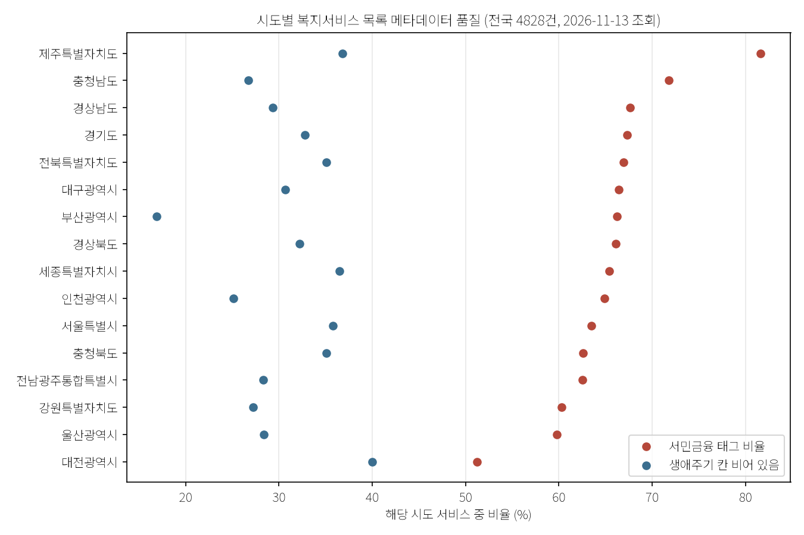

# 데이터 분석: 전국 지자체 복지서비스 메타데이터 품질 진단

- 조회일 2026-11-13, 정보원 지자체복지서비스 API 목록(LcgvWelfarelist) 전수 4,828건(17개 시도 중 광주+전남은 API상 '전남광주통합특별시' 1개로 통합되어 16개 단위). 상세는 받지 않았고 서울 397건 상세 캐시만 비교에 썼다.
- **'서민금융' 관심주제 태그가 3,165건(65.6%)에 붙어 있다.** 이 중 3,016건(95.3%, 전체의 62.5%)은 서비스명·요약에 금융 관련어가 하나도 없다. 서울(252건, 63.5%)만의 현상이 아니라 16개 단위 모두에서 51.2~81.6%로 나타난다.
- 생애주기 칸이 빈 서비스는 전국 1,470건(30.4%), 대상특성 칸이 빈 서비스는 2,779건(57.6%)이다. 서울의 생애주기 공란 142건(35.8%)은 전국 값과 같은 수준이다.
- (정규식 기반) 요약문에 소득 조건 문구가 있으나 '저소득' 대상특성 태그가 없는 서비스가 전국 371건(7.7%). 연령 조건은 요약이 짧아 거의 잡히지 않는다(목록 기준 243건). 서울 상세 본문 기준으로는 소득 177건 중 82건(20.7%)이 태그 없음이다.
- 시사점: 공식 태그 필터만으로는 재안내 후보를 찾지도(공란), 거르지도(오부착) 못하므로 본문 조건을 읽는 단계가 필요하다. 다만 오부착 판정은 단어 목록 기준이므로 건별 검수 전에는 '불일치 후보'로 표현한다.

## 제안서용 표 (시도별)

| 시도 | 서비스 수 | '서민금융' 태그 % | 태그 건 중 금융어 없음 % (건수) | 생애주기 비어 있음 % | 대상특성 비어 있음 % | 소득 문구 있으나 '저소득' 태그 없음 % |
|---|--:|--:|--:|--:|--:|--:|
| 경기도 | 692 | 67.3 | 92.7 (432) | 32.8 | 57.2 | 7.4 |
| 전남광주통합특별시 | 555 | 62.5 | 95.1 (330) | 28.3 | 66.5 | 9.2 |
| 경상남도 | 488 | 67.6 | 93.3 (308) | 29.3 | 61.5 | 8.6 |
| 강원특별자치도 | 401 | 60.3 | 97.5 (236) | 27.2 | 58.9 | 8.5 |
| 서울특별시 | 397 | 63.5 | 98.4 (248) | 35.8 | 41.8 | 10.3 |
| 전북특별자치도 | 396 | 66.9 | 95.1 (252) | 35.1 | 58.3 | 6.6 |
| 충청남도 | 337 | 71.8 | 93.4 (226) | 26.7 | 59.3 | 8.0 |
| 충청북도 | 302 | 62.6 | 97.4 (184) | 35.1 | 56.6 | 3.0 |
| 경상북도 | 289 | 66.1 | 97.9 (187) | 32.2 | 60.9 | 4.2 |
| 부산광역시 | 284 | 66.2 | 95.7 (180) | 16.9 | 65.1 | 8.8 |
| 인천광역시 | 191 | 64.9 | 95.2 (118) | 25.1 | 51.8 | 7.3 |
| 대구광역시 | 137 | 66.4 | 97.8 (89) | 30.7 | 48.2 | 8.8 |
| 제주특별자치도 | 125 | 81.6 | 96.1 (98) | 36.8 | 41.6 | 9.6 |
| 울산광역시 | 102 | 59.8 | 93.4 (57) | 28.4 | 62.7 | 3.9 |
| 대전광역시 | 80 | 51.2 | 97.6 (40) | 40.0 | 47.5 | 6.2 |
| 세종특별자치시 | 52 | 65.4 | 91.2 (31) | 36.5 | 57.7 | 11.5 |
| **전국** | 4,828 | 65.6 | 95.3 (3,016) | 30.4 | 57.6 | 7.7 |

원자료: `eval/results/2026-11-13_metadata_quality.json`. 차트: `eval/results/2026-11-13_metadata_quality_by_sido.png`

## 서울 비교 (같은 397건, 목록 기준 vs 상세 기준)

| 지표 | 목록 기준 | 상세(요약+지원대상+선정기준) 기준 |
|---|--:|--:|
| 서민금융 태그 | 252 (63.5%) | 252 (63.5%) (태그는 동일 필드) |
| 태그 건 중 금융어 없음 | 248 | 248 (판정 텍스트는 서비스명+요약으로 동일) |
| 생애주기 공란 | 142 (35.8%) | 142 |
| 연령 문구 포함 | 22 | 152 |
| 소득 문구 포함 | 106 | 177 |
| 소득 문구 있고 '저소득' 태그 없음 | 41 | 82 |

목록 요약만 보면 연령 문구는 22건, 본문까지 보면 152건이라 **목록 기준 연령·소득 수치는 과소 추정**이다. 전국 연령/소득 수치도 같은 방향으로 과소하다. 기획구상안 §5.2의 '연령 149건·소득 116건'은 정규식·텍스트 범위 정의가 달라 이번 값(연령 152건·소득 177건)과 일치하지 않는다. 제안서에는 이 문서의 정의를 명시하고 한쪽으로 통일해야 한다. (§5.2의 '서민금융 252건(63%)'과 '생애주기 공란 142건(36%)'은 재현되었다.)
분모 주의: '서민금융 63%'는 전체 397건 기준이고, 관심주제 태그가 있는 288건만 보면 87.5%이다.

## 불일치 후보 예시 ('서민금융' 태그인데 서비스명·요약에 금융어 없음)

- [서울특별시 성동구] 성동구 청년 등 탈모 치료 지원 — 요약: "청년 등의 탈모로 인한 정신적·육제적 고통을 해소하고 자신감 넘치는 일상생활을 영위할 수 있도록 탈모 치료 " / 태그: 서민금융, 신체건강
- [서울특별시 ] 서울형 장애인 개인예산제 시범사업 — 요약: "장애인 당사자의 자기결정권 및 서비스 선택권 보장 강화" / 태그: 서민금융
- [서울특별시 ] 서울형 스마트 헬스케어 — 요약: "서울형 스마트 헬스케어 플랫폼을 활용하여 건강관리 서비스를 제공함으로써 시민의 자기주도 건강관리 능력 향상 " / 태그: 서민금융
- [서울특별시 ] 자녀출산 무주택가구 주거비 지원 — 요약: "무주택 가구의 주거비 부담을 줄여 안정된 주거환경 속에서 자녀를 출산 할 수 있도록 지원하고자 함" / 태그: 서민금융, 입양·위탁, 임신·출산
- [서울특별시 서대문구] 서대문구 다자녀가족 입학축하상품권 지원사업 — 요약: "둘째아 이상 다자녀가정이 초등학교 입학 시 입학축하상품권을 지급하여 경제적 부담을 덜고 양육친화적인 환경을 " / 태그: 서민금융, 교육
- [서울특별시 은평구] 저소득주민 국민건강보험료 지원 — 요약: "생활에 어려움을 겪고 있으나, 수급권자에 해당되지 않는 저소득 주민에게 건강보험료를 지원함으로써 건강증진과 " / 태그: 서민금융
- [부산광역시 북구] 참전유공자 사망위로금 지급 — 요약: "국가에 헌신 공헌한 참전유공자에 대한 예우와 지원을 통해 자긍심 고취 및 명예 선양함으로써 구민의 나라사랑 " / 태그: 서민금융, 안전·위기
- [인천광역시 ] 전몰군경유가족수당 지원 — 요약: "국가에 헌신 공헌한 전몰군경 유가족에게 전몰군경유가족 수당을 지원하여 예우 및 삶의 질 향상" / 태그: 서민금융
- [경기도 성남시] 저소득중증청각장애인재활치료비지원 — 요약: "청각장애인 재활 치료비 지원으로 의료비부담 경감" / 태그: 서민금융, 신체건강
- [경기도 이천시] 산모신생아 건강관리 서비스 본인부담금 지원 — 요약: "산모·신생아 건강관리 서비스 비용 중 본인부담금을 일부 지원하여 출산가정의 경제적 부담을 경감" / 태그: 서민금융, 임신·출산

## 방법
- 수집: `prototype/scripts/fetch_local_list_all.py` — 시도별 `ctpvNm` 조회, 100건/쪽, 1초 간격, 429 시 저장 후 중단·재실행 시 이어받기. 결과 `data/cache/local_list_전국.json`(servId 중복 없음, 합계 4,828 = API totalCount 합).
- 분석 재현: `python3 prototype/scripts/analyze_metadata_quality.py`
- 금융 관련어 목록(서비스명+요약에 하나라도 있으면 일치): 대출, 융자, 금융, 신용, 채무, 부채, 이자, 이차보전, 보증, 햇살론, 저축, 적금, 통장, 자산형성, 연체, 파산, 회생, 학자금, 창업자금, 자금, 상환, 대부, 근로자 생활안정, 생활안정자금
- 연령 정규식: `(만\s*)?\d{1,3}\s*세\s*(이상|이하|미만|초과|까지)|\d{1,3}\s*[~\-～]\s*\d{1,3}\s*세|\d{1,3}\s*세\s*[~\-～]|(19|20)\d{2}\s*[.년]\s*\d{1,2}\s*[.월]\s*\d{1,2}\s*[.일]?\s*(이후|이전|생)`
- 소득 정규식: `중위\s*소득|소득\s*(인정액|기준|하위|상위|\s*\d)|\d{2,3}\s*%\s*(이하|미만)|기초생활|기초수급|차상위|저소득|수급자|수급권자|건강보험료`
- '소득 문구 있고 태그 없음' = 소득 정규식 일치 and 대상특성(trgterIndvdlNmArray)에 '저소득' 없음. '연령 문구 있고 태그 없음' = 연령 정규식 일치 and 생애주기 공란.

## 한계
- 불일치 판정은 단어 목록 방식이라 '자금·보증' 같은 단어가 우연히 들어가면 일치로 보고, 금융 성격이어도 단어가 없으면 불일치로 본다. 무작위 표본 사람 검수는 아직 하지 않았다.
- 전국 연령·소득 수치는 목록 요약문(짧음) 기준이라 하한에 가깝다. 상세 4,828건 수집은 쿼터 때문에 하지 않았다.
- 서울 외 시도에서 '서민금융' 태그가 왜 붙는지(입력 관행인지 API 변환 문제인지)는 확인하지 못했다. 정보원에 문의가 필요하다(미확인).
- 대상특성 태그에는 연령·소득 외 값(저소득, 장애인, 보훈대상자 등 6종)만 있어 '대상특성 공란'은 해당 6종에 모두 속하지 않는 서비스까지 포함한다.
- 광주·전남은 API에서 합쳐져 있어 분리 집계하지 못한다.
