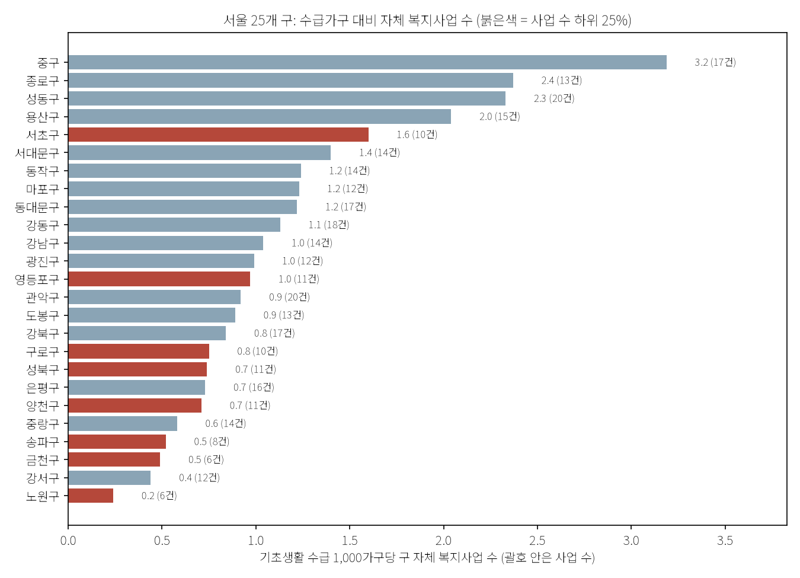

# 데이터 분석: 수급권자 현황 × 자치구 자체 복지사업 수

- 서울 25개 구의 자체 복지사업은 합계 331건(서울시 본청·교육청 등 구 미지정 66건 제외)이고, 구별로 6~20건으로 차이가 크다.
- 기초생활(맞춤형급여) 수급 1,000가구당 구 자체 사업 수는 중구 3.19건이 가장 높고, 노원구 0.24건(6건/25,401가구)이 가장 낮다. 최고/최저 비율은 약 13.5배(3.19/0.24, 원값 17/5,330 대 6/25,401).
- 구 자체 사업 수가 하위 25%(서울 25개 구 기준 11건 이하)인 구는 8곳이다: 서초구, 영등포구, 구로구, 성북구, 양천구, 송파구, 금천구, 노원구. 이 구들은 구 단위 재안내 후보가 비는 위험이 상대적으로 높다고 본다(휴리스틱, 아래 한계 참조).
- 수급가구수와 구 자체 사업 수(원값)의 Spearman 상관은 -0.03(p=0.91, n=25)으로 사실상 없다. 이전 판의 -0.76은 수급가구수와 "사업 수/수급가구수"의 상관이라 분모가 같은 값끼리 비교한 허위상관이어서 삭제했다. 단순 사업 개수일 뿐 예산·수혜 규모는 아니다.
- 전국 229개 시군구 중 사업 수 0으로 잡힌 곳은 2곳이지만 둘 다 실제 0이 아니라 이름 불일치/행정개편 때문이다(세종, 인천 서구). 이름 매칭 문제는 아래에 정리했다.

## 제안서용 표 (서울 25개 구, 1,000가구당 사업 수 내림차순)

| 순위 | 자치구 | 기초생활 수급가구 | 구 자체 사업 수 | 1,000가구당 사업 수 | 저소득 대상특성 태그 사업 | 서울 상세 기준 소득 문구 사업 | 재안내 후보 0개 위험 |
|--:|---|--:|--:|--:|--:|--:|---|
| 1 | 중구 | 5,330 | 17 | 3.19 | 4 | 8 | - |
| 2 | 종로구 | 5,477 | 13 | 2.37 | 4 | 7 | - |
| 3 | 성동구 | 8,575 | 20 | 2.33 | 2 | 8 | - |
| 4 | 용산구 | 7,369 | 15 | 2.04 | 4 | 4 | - |
| 5 | 서초구 | 6,245 | 10 | 1.6 | 2 | 4 | 높음 |
| 6 | 서대문구 | 9,998 | 14 | 1.4 | 6 | 9 | - |
| 7 | 동작구 | 11,322 | 14 | 1.24 | 3 | 3 | - |
| 8 | 마포구 | 9,748 | 12 | 1.23 | 4 | 7 | - |
| 9 | 동대문구 | 13,892 | 17 | 1.22 | 5 | 7 | - |
| 10 | 강동구 | 15,984 | 18 | 1.13 | 4 | 6 | - |
| 11 | 강남구 | 13,500 | 14 | 1.04 | 3 | 6 | - |
| 12 | 광진구 | 12,098 | 12 | 0.99 | 6 | 7 | - |
| 13 | 영등포구 | 11,291 | 11 | 0.97 | 4 | 5 | 높음 |
| 14 | 관악구 | 21,667 | 20 | 0.92 | 4 | 6 | - |
| 15 | 도봉구 | 14,533 | 13 | 0.89 | 6 | 6 | - |
| 16 | 강북구 | 20,351 | 17 | 0.84 | 4 | 8 | - |
| 17 | 구로구 | 13,412 | 10 | 0.75 | 5 | 5 | 높음 |
| 18 | 성북구 | 14,820 | 11 | 0.74 | 2 | 4 | 높음 |
| 19 | 은평구 | 21,845 | 16 | 0.73 | 5 | 9 | - |
| 20 | 양천구 | 15,490 | 11 | 0.71 | 4 | 8 | 높음 |
| 21 | 중랑구 | 24,029 | 14 | 0.58 | 1 | 2 | - |
| 22 | 송파구 | 15,455 | 8 | 0.52 | 1 | 4 | 높음 |
| 23 | 금천구 | 12,368 | 6 | 0.49 | 0 | 2 | 높음 |
| 24 | 강서구 | 27,028 | 12 | 0.44 | 2 | 7 | - |
| 25 | 노원구 | 25,401 | 6 | 0.24 | 1 | 2 | 높음 |

원자료: `eval/results/2026-11-13_sgg_services.json`, 전국 시군구 표 `eval/results/2026-11-13_sgg_services_national.csv`. 차트: `eval/results/2026-11-13_sgg_services_seoul.png`

## 전국 현황
- 전국 시군구 단위 229곳(일반구는 시 단위로 합산, 광주+전남은 통합 시도 1개). 사업 수 3건 이하 3곳. 하위 25% 기준선은 11건 이하.
- 수급 1,000가구당 사업 수가 낮은 시군구 (이름 불일치로 0인 2곳 제외 상위):

| 시군구 | 수급가구 | 자체 사업 수 | 1,000가구당 |
|---|--:|--:|--:|
| 세종특별자치시 세종특별자치시 | 6,857 | 0 | 0.0 |
| 인천광역시 서구 | 23,551 | 0 | 0.0 |
| 인천광역시 남동구 | 29,228 | 5 | 0.17 |
| 서울특별시 노원구 | 25,401 | 6 | 0.24 |
| 인천광역시 미추홀구 | 24,128 | 6 | 0.25 |
| 대구광역시 동구 | 19,627 | 5 | 0.25 |
| 부산광역시 금정구 | 12,360 | 4 | 0.32 |
| 경상북도 포항시 | 26,175 | 9 | 0.34 |

- 시도별 중앙값은 JSON `national_by_sido`에 있다. 군 지역은 가구 수가 작아 1,000가구당 값이 크게 나오므로 도시와 직접 비교하지 않는다.

## 이름 매칭 문제
- 같은 이름이 여러 시도에 있다(중구·동구·서구·남구·북구·강서구). 시도+시군구 쌍으로만 결합했다.
- CSV는 일반구를 따로 둔다(수원시장안구, 고양시덕양구 등 공백 유무도 혼재). API `sggNm`은 시 단위(수원시)이므로 CSV를 시 단위로 합산했다. 시 단위 구분 사업은 구별로 나눌 수 없다.
- 광주광역시·전라남도: CSV(2025-12)는 둘이 분리, API는 '전남광주통합특별시' 1개이므로 CSV도 합쳐서 결합했다. 구 명칭(광주광역시, 전라남도)으로 API를 조회하면 NO DATA가 나온다.
- 인천: API에 제물포구·영종구·서해구가 있고 CSV(2025-12)에는 없다(행정구역 개편으로 추정, 대응표는 확인하지 못함). 결합 실패 API 사업은 30건: 인천광역시 제물포구(14건), 인천광역시 영종구(11건), 인천광역시 서해구(5건). 인천 서구 CSV는 대응 사업 0건으로 남고 인천 중구·동구는 일부만 잡혔을 가능성이 있다.
- 세종특별자치시: API 52건 중 48건이 시군구 미지정이고 4건은 '세종특별자치시교육청' 등 교육청 값이라 결합할 대상이 없다. 세종 값은 해석하지 않는다.
- sggNm이 비었거나 '-' 또는 교육청인 사업은 전국 838건으로 구 자체 사업에서 제외했다(시도 본청·교육청 사업).
- 결합된 API 사업: 3960건.

## 방법
- 분모: CSV '기초생활보장(맞춤형급여)' 수급가구수(2025-12, cp949). 사업 수: `data/cache/local_list_전국.json`에서 `sggNm`이 해당 시군구인 서비스 개수. 지표 = 사업 수 / (수급가구수/1000).
- '저소득 대상특성 태그 사업' = 대상특성에 '저소득'이 있는 사업. '서울 상세 기준 소득 문구 사업' = 서울 상세 캐시의 요약·지원대상·선정기준에서 소득 정규식이 일치한 구 자체 사업(정규식은 메타데이터 품질 문서와 동일).
- 위험 플래그: 서울 25개 구에서 자체 사업 수가 하위 사분위(numpy percentile 25 = 11) 이하.
- 재현: `python3 prototype/scripts/analyze_sgg_services.py`

## 한계
- 사업 '개수'는 사업의 크기·예산·대상 범위를 반영하지 않는다. 같은 1건이 구 전체 주민 대상일 수도, 소수 대상일 수도 있다.
- '후보 0개 위험'은 실제 재안내 후보 0개 발생률을 측정한 값이 아니다. 후보는 서울시 본청·중앙부처 사업도 포함하고 가구별 조건에 따라 달라지므로, 이 플래그는 구 단위 자체 사업 풀이 얇은 구를 가리는 대리 지표다. 실제 0개 비율은 가상 가구 매칭 실험(F3)으로 따로 측정해야 한다.
- 1,000가구당 지표는 수급가구가 적은 구에서 값이 부풀려진다(중구·종로구).
- 목록의 sggNm은 담당 부서 소재 기준으로 보이며 수혜 구와 다를 수 있다(확인하지 못함). 서울 목록 중 sggNm이 있는 사업의 부서명 검증은 하지 않았다.
- 수급자 CSV 기준일(2025-12)과 API 조회일(2026-11-13)이 달라 행정개편 영향이 있다.
